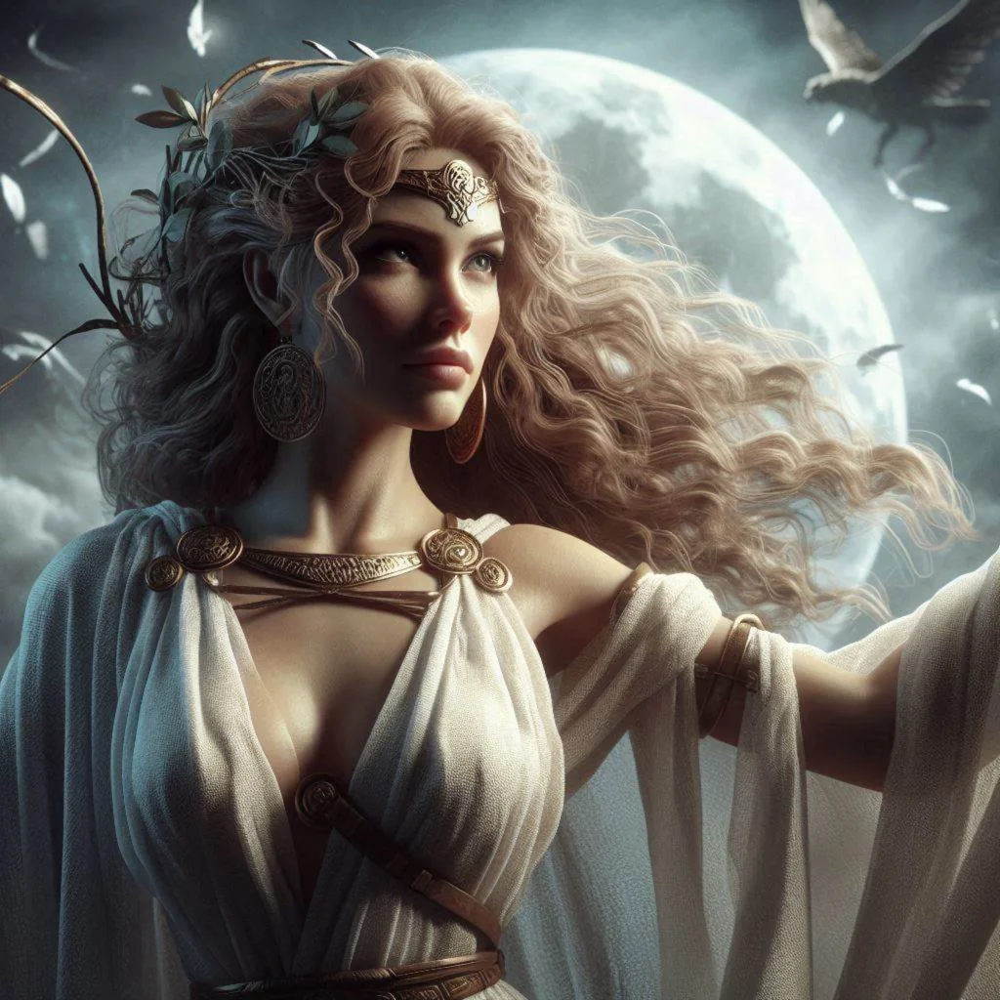

_Główna sekretarz królowej Vallus_

## Historia
Obecna podczas rytuału na [[Góra Volkana|Górze Volkana]].

W [[Sesja 85 - Cienie nad Arezją]] powitała [[Bohaterowie Przepowiedni|Bohaterów Przepowiedni]] w [[Pałac Królewski w Mytros|pałacu]] i zaprowadziła ich do prywatnych komnat [[Vallus]].
