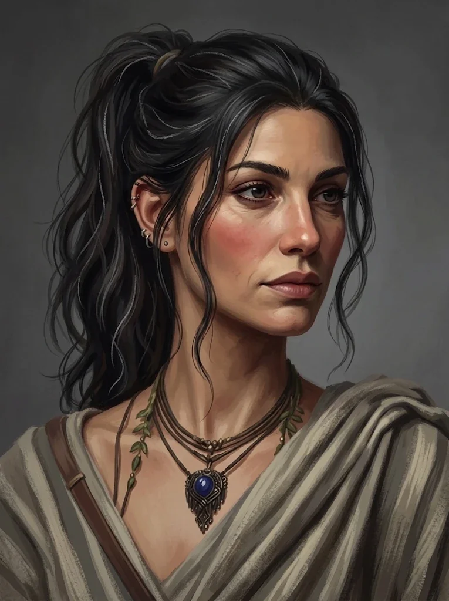

_Kapłanka Mytros, Żona Felicjana_

## Historia
Ukochana żona [[Felicjan Janus Twardowski|Felicjana]]. Jako kapłanka Mytros służy w mieście.

W [[Sesja 17 - Targ Minotaurów]] spotkała się z drużyną w Świątyni Pięciu. W [[Sesja 20 - Noc Długich Rogów]], podczas zamieszek w mieście, u Melanii wszystko było dobrze; Felicjan poprosił ją, by nie wychodziła z domu.

W [[Sesja 30 - Zakończenie Igrzysk]] zatańczyła z Felicjanem na uczcie u [[Taran Neurdagon|Tarana]]. W [[Sesja 31 - Wyprawa na Themis]] dołączyła do drużyny (załogi) przed wyprawą na [[Themis]].

W [[Sesja 41 - Wiedźma Lotosu]] w wizji z Korytarza Światów leżała martwa obok Felicjana w płonącym Mytros. W [[Sesja 54 - Wyznanie Chondrusa]] poprosiła męża, by po wojnie wrócił z nią do domu. W [[Sesja 57 - Ogród Heliosa]] rzuciła na [[Orestes|Orestesa]] potężne zaklęcie zdjęcia klątwy. W [[Sesja 58 - Wyspa Czasu]] w wizji Felicjana z teleskopu ukazała się jako żona, która nie przetrwała wojny.

W [[Sesja 59 - Koniec Imprezy]] towarzyszyła bohaterom wznoszącym się ku latającej fortecy, razem z [[Astra|Astrą]] i [[Lyra|Lyrą]]. W [[Sesja 65 - Wyprawa w Otchłań]] zaalarmowała Felicjana o pękaniu smoczego jaja w jego kajucie.

W [[Sesja 73 - Praxys - Skarbiec Sydona]] towarzyszyła drużynie jako kapłanka i rozpoznała w czaszce szczątki [[Balmytria|Balmytrii]]. W [[Sesja 74 - Matka Smoków]] zapytała Felicjana, jak „oni" zareagują na widok [[Nephele (Smok)|Nephele]]; przyglądała się smoczycy, czaszce Balmytrii i Felicjanowi, a między nią a Felicjanem wywiązała się enigmatyczna wymiana, jakby łączyła w głowie puzzle niewidoczne dla reszty drużyny.
