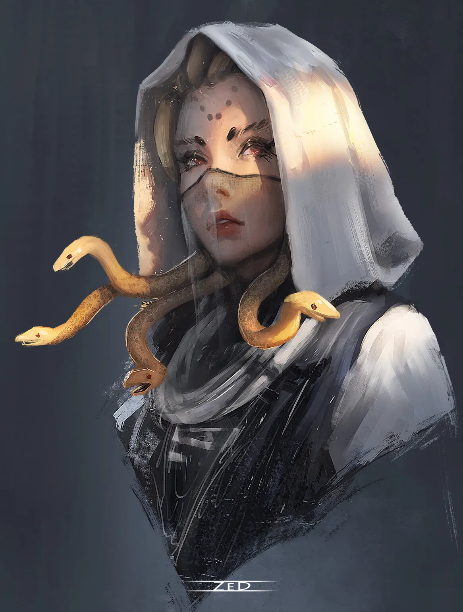

_Tajemnicza "Pani Monet", okazała się być Meduzą porywającą artystów; zawarła z drużyną przymierze i została na Themis jako doradczyni Darien._

## Opis
Moxena jest Meduzą, choć przez długi czas ukrywała swoją naturę pod kapturami i maskami. Pochodzi z [[Themis|Wyspy Themis]]. Po rewolucji na Themis została tam jako doradczyni [[Darien]] i zbierała informacje dla drużyny; później podróżowała z amazońskimi wojowniczkami, a jej statek nosił barwy Themis.

## Osobowość
Przebiegła, zdeterminowana, ale też trawiona poczuciem winy. Twierdzi, że jej cele są "szlachetne".

## Historia
Pochodzi z [[Themis|Wyspy Themis]], gdzie kilkanaście lat temu wraz z siostrami dokonała przewrotu i przejęła władzę (ujawnione w [[Sesja 22 - Taniec z Meduzą]]).

Jest siostrą fałszywej królowej Amazonek. Wraz z siostrami zabiła prawdziwą królową Amazonek i uwięziła jej córkę [[Darien]]. Moxena przez lata żyła z poczuciem winy z powodu tych wydarzeń, co stało się zarzewiem jej dążenia do naprawienia wyrządzonych krzywd.

Jako **Pani Monet** (*The Lady of Coins*) była uważana za przywódczynię [[Kult Węża|Kultu Węża]] (gildia złodziei), okradając bogatych, by wykupować niewolników (np. minotaury).

### Działalność w Mytros
W [[Mytros]] znana była jako "Pani Monet". W [[Sesja 19 - Pojedynek z Rozpruwaczem]] [[Versir]] sprzedał jej plany drużyny (prawdopodobnie miała obrabować dom [[Maximus|Maximusa]] przed bohaterami), a [[Taran Neurdagon]] zaproponował [[Orion Xul|Orionowi]] pozbycie się jej i [[Kult Węża|Kultu Węża]] za 10 000 sztuk złota. W [[Sesja 20 - Noc Długich Rogów]] podejrzenia o zabicie strażników z magazynów padły na Kult Węża i Moxenę.

W [[Sesja 21 - Ukryte pragnienia Ismene]] jej działalność została ujawniona przez [[Astra|Astrę]], która doniosła [[Versir|Versirowi]], że Moxena zawarła układ z [[Hexia|Hexią]]: porywa i sprzedaje jej skamieniałych artystów za pośrednictwem [[Varkon|Varkona]], czego nie wiedzieli nawet w Kulcie Węża. Dla Moxeny pracowała też [[Rhea]], władająca magią. Drużyna odkryła również jej siatkę szpiegowską ([[Greciosa]] i [[Nera]]) oraz miejsce spotkań ([[Satyrzy Ogon]]); Versir, który współpracował z Moxeną, został oskarżony o zdradę, a okazało się, że Moxena jest meduzą.

### Sojusz z Drużyną
W [[Sesja 22 - Taniec z Meduzą]] Moxena zaproponowała spotkanie w siedzibie Kultu Węża, ale drużyna nalegała na kanały; tam, w potrzasku, zaproponowała bohaterom układ. Ujawniła, że chce wrócić na [[Themis|Wyspę Themis]], aby obalić fałszywą królową uzurpującą władzę i naprawić wielką krzywdę, którą popełniła w młodości. Bohaterowie zobowiązali się jej w tym pomóc. W zamian Moxena zobowiązała się natychmiast zaprzestać porywania artystów w Mytros i obiecała w przyszłości pomóc w rozprawieniu się z Hexią. Ukrywa swoje motywy przed [[Lutheria|Lutherią]]: drużyna złożyła przysięgę, że nie wyjawi ich żadnemu jej słudze. Rhea odpowiedziała w tej scenie Counterspellem na Vortex Warp Versira.

W [[Sesja 23 - Nowe Przymierze]] sformalizowała układ w [[Kolos Pythora|Kolosie Pythora]], ostatecznie akceptując propozycję drużyny (już nie zagrażała Mytros), i przekazała bohaterom mapę [[Posiadłość Neurdagonów|Posiadłości Neurdagonów]].

### Wyprawa na Themis
W [[Sesja 31 - Wyprawa na Themis]] dołączyła do drużyny (załogi) przed wyprawą na [[Themis]]; w porcie Aella wraz z [[Astra|Astrą]] wyruszyła na poszukiwanie kontaktu do ruchu oporu. W [[Sesja 32 - Kieł]] pod koniec sesji próbowała nawiązać kontakt z uwolnioną [[Darien]], a wyrocznia wskazała, że nie spróbuje zdradzić drużyny. Jej siostrą jest [[Leah]] ([[Sesja 33 - W Szponach Bazyliszków]], [[Sesja 35 - W Wężowym Uścisku]]).

W [[Sesja 36 - Królowa, Dziedzic i Generał]] zgodziła się na obcięcie głowy swojej siostry Lei. Poprosiła drużynę o zwolnienie z przysięgi, by służyć Darien jako doradczyni; bohaterowie zgodzili się, by została na Themis i zbierała informacje. Następnego dnia w imieniu Darien wręczyła bohaterom koronę wartą 5000 sztuk złota.

### Później
W [[Sesja 64 - Pieśń dla Smoczycy]] przybyła na [[Wyspa Smoka|Wyspę Smoka]] na wezwanie, zgodnie z umową, jako Pani Monet; jej statek nosił barwy Themis, a podróżowała w towarzystwie amazońskich wojowniczek. Przekazała bohaterom informacje o topografii i mieszkańcach wyspy i pozostała w gotowości do wsparcia. Po pomyślnych negocjacjach ze smokiem zgodziła się zabrać na swój statek "bardziej użytecznych" uchodźców z [[Latająca Forteca Smoczych Lordów|latającej fortecy]].

W [[Sesja 77 - Bitwa o Mytros: Upadek Icarusa]] została wymieniona jako kandydatka na pilota Kolosa.

### Po wojnie
[[Felicjan Janus Twardowski|Felicjan]] chciał ją zwerbować do [[Zakon Smoczych Lordów|Zakonu Smoczych Lordów]]: mało kto w Thylei wie tyle co ona i mało kto potrafi tak długo milczeć. Moxena odmówiła i została na [[Themis]], choć [[Darien]], której doradzała, zginęła w wojnie. Z Zakonem łączą ją jednak przyjacielskie stosunki.
