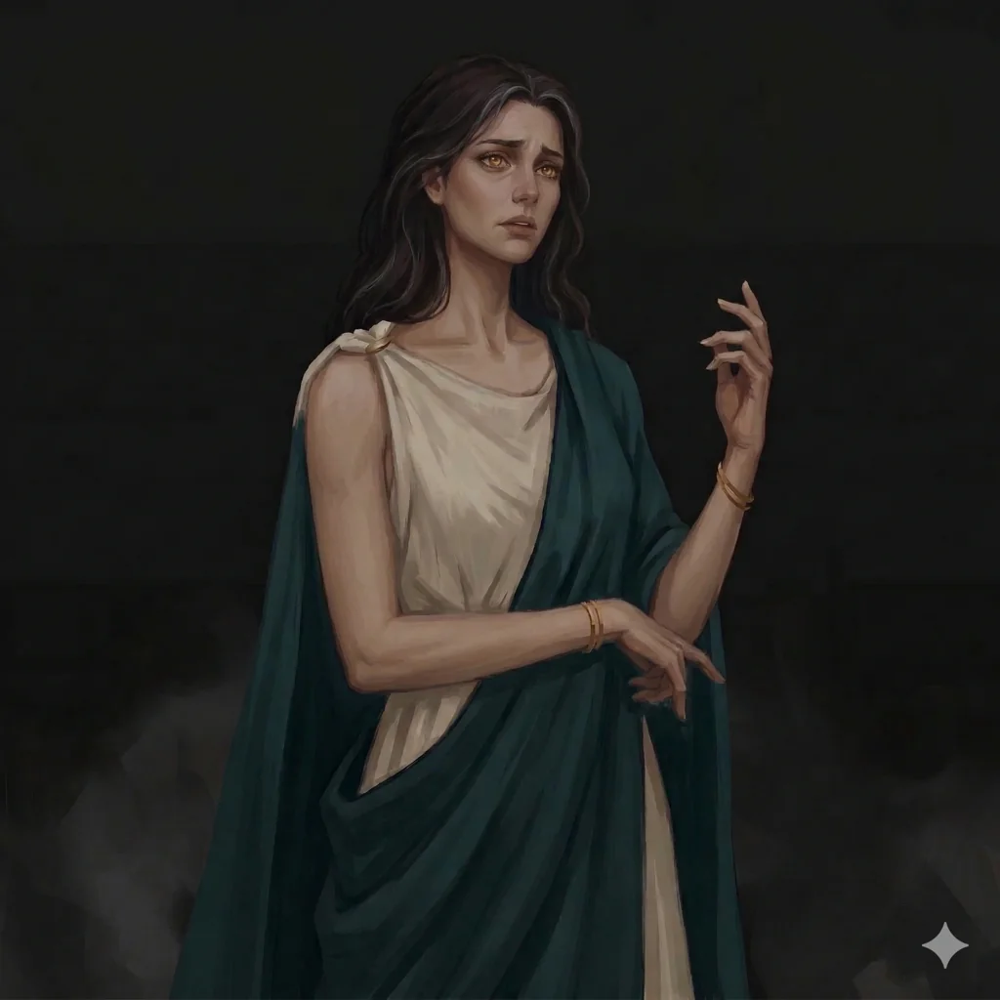

_Bogata szlachcianka._

## Opis
Nephele to zamożna kobieta, która szukała minotaura na targu niewolników. Nie mylić ze smoczycą [[Nephele (Smok)]].

## Historia
W [[Sesja 17 - Targ Minotaurów]] szukała minotaura na targu niewolników i poprosiła, by [[Orestes]] walczył z [[Bullbug]]. Orestes wygrał, ale odmówił zabicia przeciwniczki. [[Hoobert]] zrobił coś niestosownego wobec Nephele.
