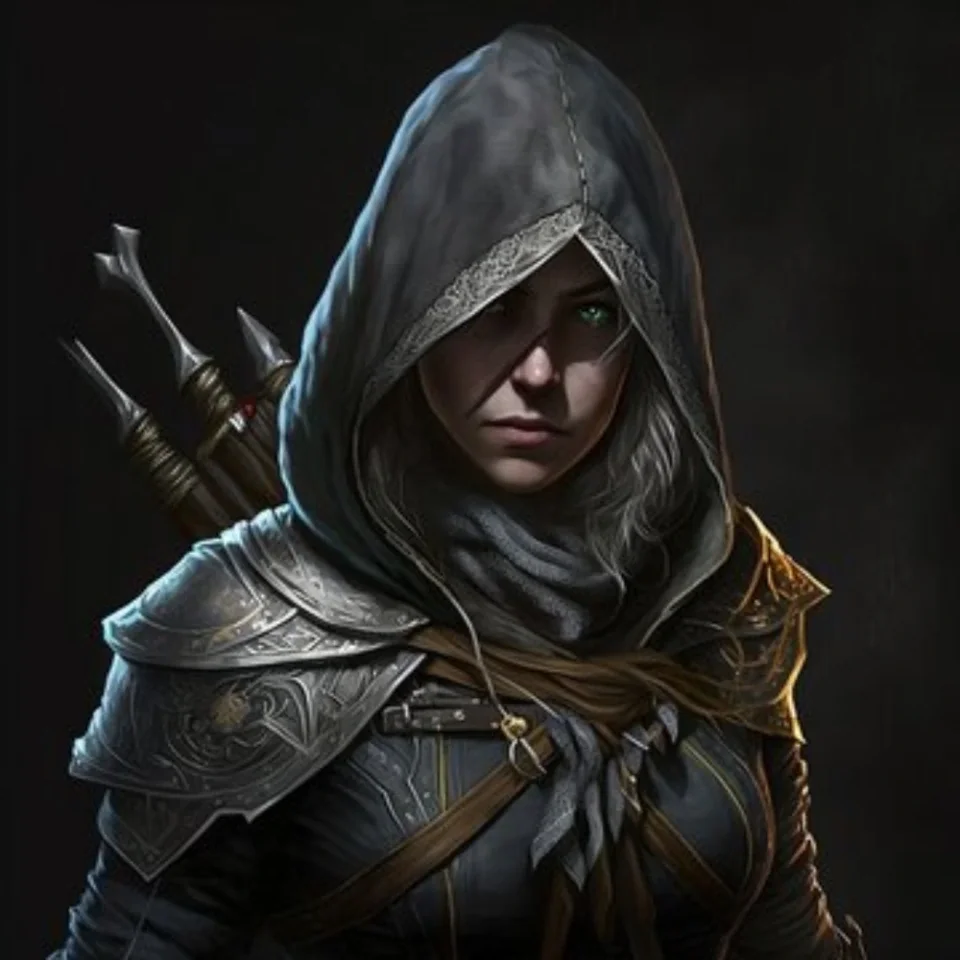

_Złodziejka i członkini Kultu Węża._

## Opis
Nera to siostra **[[Greciosa|Greciosy]]**. Często przesiaduje w **[[Satyrzy Ogon]]**, świętując udane kradzieże. Jest członkinią **[[Kult Węża|Kultu Węża]]** i szpiegiem.

## Historia
W [[Sesja 21 - Ukryte pragnienia Ismene]] przebywała w [[Satyrzy Ogon|Satyrzym Ogonie]] i wraz z [[Greciosa|Greciosą]] śledziła drużynę. Obie zostały złapane i przesłuchane (na statku [[Varkon|Varkona]]); podczas przesłuchania ujawniły prawdziwą naturę [[Moxena|Moxeny]], a Nera oskarżyła [[Versir|Versira]] o zdradę.

W [[Sesja 22 - Taniec z Meduzą]] drużyna odprowadziła ją i Greciosę do [[Vallus]], która obiecała przetrzymać je z dala od króla [[Acastus|Acastusa]].
