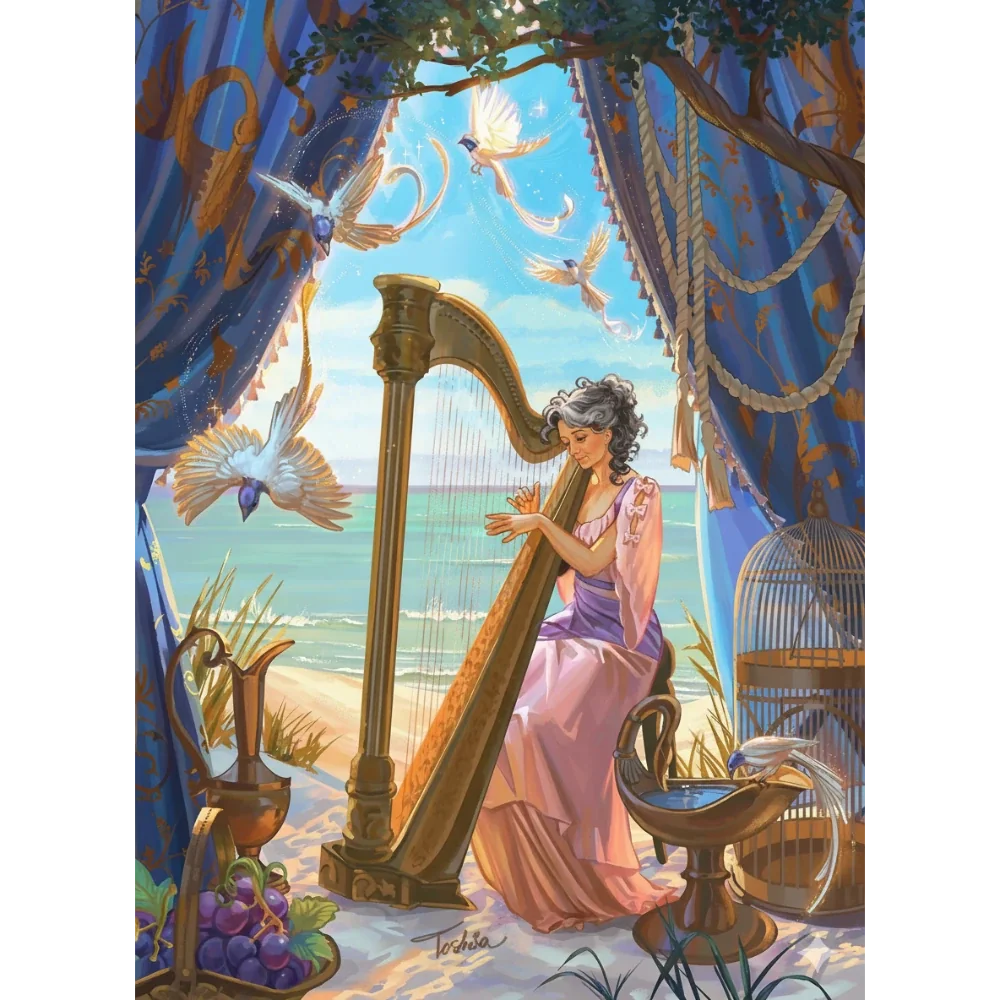

_Matka Oriona Xula, dawna kochanka Pythora._

## Opis
Starsza półelficka kobieta o szlachetnych rysach, choć naznaczona latami niewoli.

Jest matką [[Orion Xul|Oriona]]. Została uwolniona z niewoli [[Hexia|Hexii]]; po pogodzeniu się Pythora z Hexią rozmowa z nią stała się teoretycznie możliwa ([[Sesja 84 - Świt Nowej Ery]]).

## Historia
Ophea była kochanką [[Pythor|Pythora]], z którym ma syna, [[Orion Xul|Oriona Xula]]. Przez dekady była przetrzymywana przez zazdrosną smoczycę [[Hexia|Hexię]] na [[Wyspa Smoka|Wyspie Smoka]].

W [[Sesja 64 - Pieśń dla Smoczycy]] została uwolniona przez swojego syna, Oriona, oraz jego towarzyszy, po tym jak Hexia zgodziła się ją oddać (głównie dzięki pieśni [[Orestes|Orestesa]] i dyplomacji). Hexia nakazała Orionowi trzymać matkę z dala od Pythora.

W [[Sesja 84 - Świt Nowej Ery]] Orion dopytywał o matkę; po pogodzeniu się Pythora z Hexią rozmowa z nią stała się teoretycznie możliwa, choć sam Pythor pewnie by się jej bał.

## Po wojnie
[[Pythor]] przez lata po wojnie nabrał w końcu odwagi i nie raz z nią rozmawiał, także o tym, czemu nie ruszył jej na ratunek od razu. Romantycznej miłości między nimi już nie ma, ale jest zrozumienie. Jej syn, [[Orion Xul|Orion]], wędruje z ojcem po [[Kontynent Thylea|Thylei]].

W [[Sesja 85 - Cienie nad Arezją]] [[Pythor]] opowiedział Orionowi, że odwiedził ją w pałacu: przez godzinę łuskał z nią bób pod cyprysami i słuchał narzekań na wiatr niszczący róże i przesolone jedzenie, aż zaprosiła ich obu na kolację.
