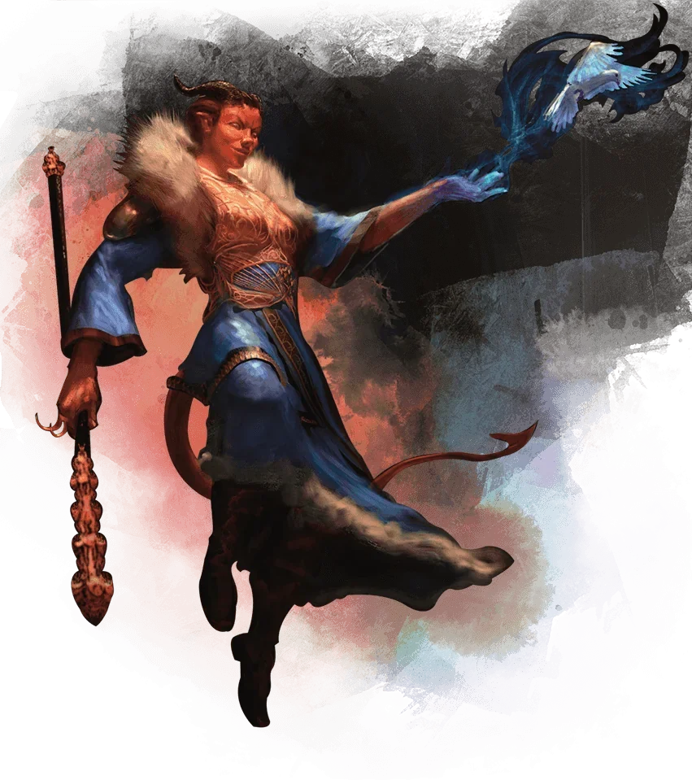

_Czarodziejka pracująca dla Moxeny._

## Opis
Czarodziejka władająca magią, która wykonywała zadania dla [[Moxena|Moxeny]]; po zawarciu przymierza dołączyła do drużyny (załogi).

## Historia
W [[Sesja 21 - Ukryte pragnienia Ismene]] [[Astra]] wyjawiła, że Rhea, władająca magią, pracuje dla [[Moxena|Moxeny]].

Pomagała w procedurze porywania i transportu skamieniałych ofiar.

W [[Sesja 22 - Taniec z Meduzą]] odpowiedziała Counterspellem na Vortex Warp [[Versir|Versira]].

W [[Sesja 31 - Wyprawa na Themis]] dołączyła do drużyny (załogi) przed wyprawą na [[Themis]]. W [[Sesja 36 - Królowa, Dziedzic i Generał]] wyszła z pałacu z [[Hippolyta|Hippolytą]] i [[Darien]] po rewolucji.
