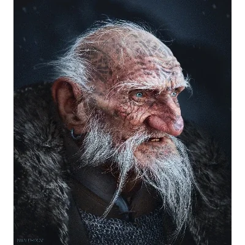

_Starożytny Żeglarz._

## Opis
Samuel jest rybakiem z **[[Targ Rybny|Rybiego Targu]]**.

Samuel to krasnoludzki stary rybak, który spędził życie na morzu. Znany z opowiadania niestworzonych historii.

## Historia
W [[Sesja 18 - Cienie Mytros]] [[Orestes]] rozmawiał z nim na [[Targ Rybny|Rybim Targu]]. Samuel twierdził, że widział Wielkiego Morskiego Żółwia z miastem na grzbiecie, i opowiedział o rozbitkach z innego świata.

## Wiedza
Ma ogromną wiedzę o morzach i legendach, w tym o mieście na grzbiecie smokozółwia. Składa ofiary Sydonowi, mimo że stracił wielu towarzyszy przez morze.
