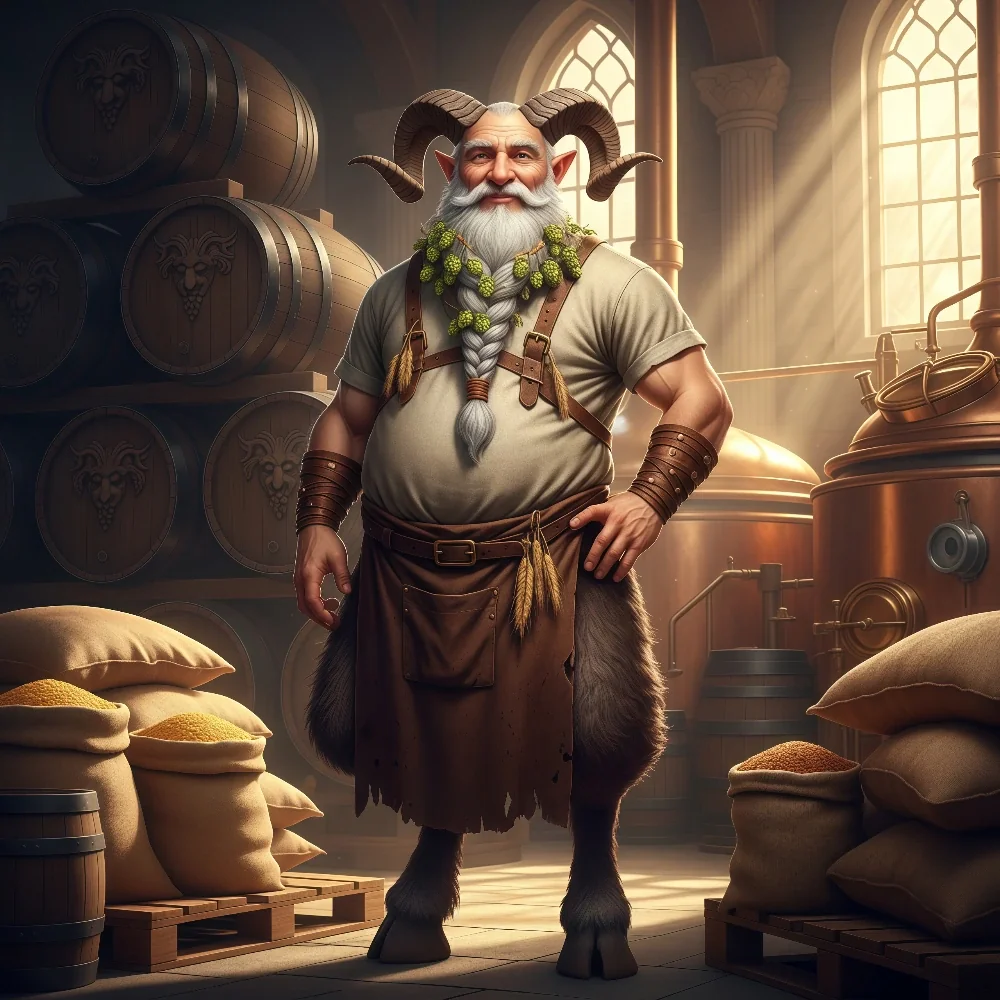

_Wuj **[[Orestes|Orestesa]]**._

## Opis
Silenos to wuj Orestesa. Przybył do Mytros, aby nawiązać kontakty handlowe w sprawie dystrybucji piwa. Dogadał się na dostarczanie 10 beczek dziennie.

Jest satyrem.

## Historia
W [[Sesja 19 - Pojedynek z Rozpruwaczem]] przybył do Mytros i umówił się na dostawę 10 beczek piwa dziennie.

W [[Sesja 55 - Egida Mytros]] konsultował z Orestesem interesy piwne, a na piwo, na które wprosił się do Orestesa [[Volkan]], dołączył również Silenos.

## Po wojnie
Jest założycielem browaru w [[Orestessos Zythikē]] i pozostaje jego głównym udziałowcem. Bieżące rządy nad browarem i całą siecią **Warlock Circus Super Bar** sprawuje jednak [[Orestes]] jako jej prezes. To Silenos przedstawił Orestesowi dalekiego kuzyna, [[Krithon|Krithona]].
