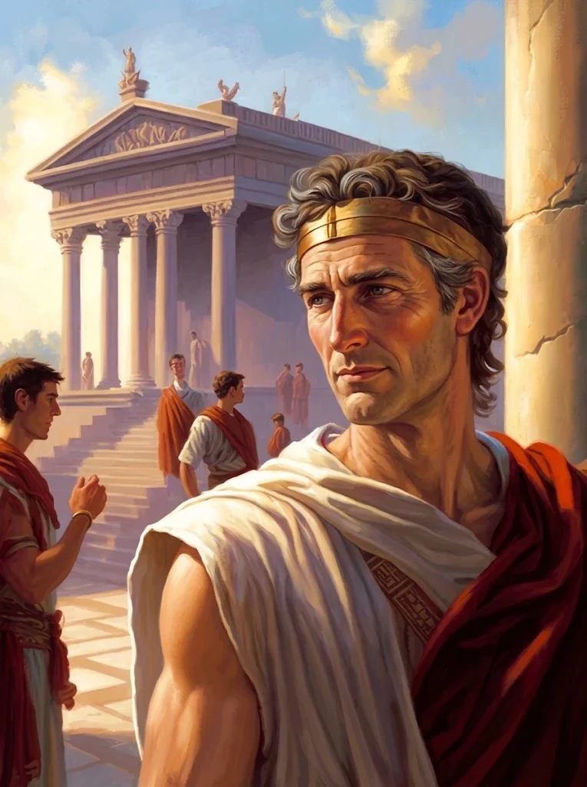
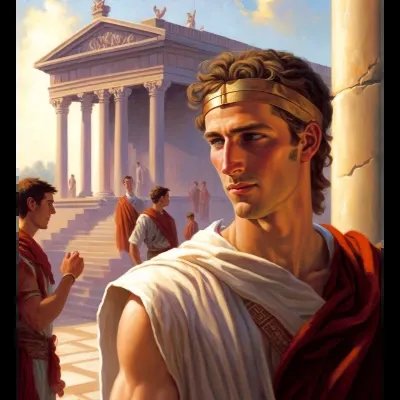

|  |  |
|:---:|:---:|
| Piętnaście lat po wojnie | W czasie wojny |

_Najmłodszy syn Tarana Neurdagona, zakochany w bogini Vallus._

## Opis
Sulla to próżny i naiwny młodzieniec, który spędza dnie pod **[[Świątynia Pięciu|Świątynią Pięciu]]**, mając nadzieję na spotkanie z boginią mądrości **[[Vallus]]**.
