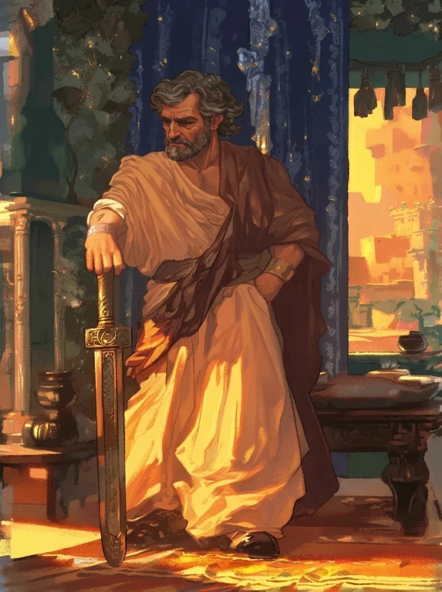

_Potężny kupiec i głowa rodu Neurdagon._

## Opis
Taran Neurdagon to bogaty kupiec i oligarcha z Mytros, potomek Smoczych Lordów. Mieszka w **[[Posiadłość Neurdagonów|Posiadłości Neurdagonów]]**. Po wojnie hojnie sfinansował odbudowę Mytros, a z czasem załatwił sobie miejsce w radzie miasta ([[Sesja 84 - Świt Nowej Ery]]).

Jest potomkiem smoczego lorda **Adonisa Neurdagona**. Jego posiadłość jest opulentna.

## Osobowość
Jest dumnym i wpływowym arystokratą. Jego bogactwo opiera się głównie na nieruchomościach i handlu, w tym (choć niechętnie się do tego przyznaje) na handlu minotaurami. Jest mściwy i nie wybacza odrzucenia.

Na uczcie w [[Sesja 30 - Zakończenie Igrzysk]] okazał się rozrzutny i wylewny; chciał wykorzystać ostatnią noc świętowania do cna.

## Historia
Jego najmłodszy syn, **[[Sulla]]**, jest dla niego źródłem wstydu z powodu swojej obsesji na punkcie królowej Vallus. Taran nienawidził [[Moxena|Pani Monet]], ponieważ jej ataki na handlarzy niewolników kosztowały go fortunę, i oferował nagrodę za jej głowę.

W [[Sesja 19 - Pojedynek z Rozpruwaczem]] zaproponował [[Orion Xul|Orionowi]] pozbycie się [[Moxena|Moxeny]] i [[Kult Węża|Kultu Węża]] za 10 000 sztuk złota; pojawił się też jako gość na wydarzeniu [[Maximus|Maximusa]]. W [[Sesja 20 - Noc Długich Rogów]] ślady oleju poprowadziły pod jego siedzibę; w kanałach ukryte były za iluzją drewniane drzwi.

W [[Sesja 21 - Ukryte pragnienia Ismene]] wspomniano próbę otrucia jego syna przez [[Stavros|Stavrosa]], jego głównego rywala w handlu winem ([[Sesja 45 - Tajemnica Wyspy Wygnańców]]).

W [[Sesja 30 - Zakończenie Igrzysk]] wyprawił wielką ucztę dla zawodników Igrzysk w swojej posiadłości, wygłosił mowę; gościł nawet [[Lutheria|Lutherię]], która przemawiała w imieniu nieobecnego [[Sydon|Sydona]].

W [[Sesja 49 - Wielkie Gęsie Powstanie]] wyszło na jaw, że Taran był odpowiedzialny za tragedię na [[Wyspa Forlorn]]. Zakochany w półelfce [[Althaia|Althai]], która odrzuciła jego zaloty, doprowadził w furii do jej przeklęcia. Po latach jego ludzie, odziani w czerń i noszący maski, przeszukiwali ruiny wyspy z instrukcjami z jego listu: mieli zabić Althaię i przynieść jej głowę. Zawarli układ z gęsimi bohaterami, zaatakowali czarownicę od tyłu, odcięli jej głowę i opuścili wyspę.

W [[Sesja 84 - Świt Nowej Ery]] sfinansował znaczną część odbudowy [[Mytros]] — zdecydowanie nie bezinteresownie: podpisywano kontrakty, dziesięcinę z zysków portowych na następną dekadę i kolejne przywileje. [[Felicjan Janus Twardowski|Felicjan]] uznał go za zarodek problemu, jaki lepiej rozwiązać zawczasu, i proponował stałą obserwację oraz zaostrzone podatki dla najbogatszych; [[Orestes]] bronił kupca, przyznając uczciwie, że nie jest obiektywny, skoro jego browar robi interesy z rodziną Neurdagonów. Rzeczywistość okazała się prozaiczniejsza od obaw: Taran z czasem załatwił sobie miejsce w radzie [[Mytros]], a kilku innych jej członków utrzymywało się z jego hojności — nigdy jednak nie na tyle, by zbudować większość, i nigdy w sposób, który dałoby się nazwać po imieniu. Lukratywna posada dla córki nie jest przecież korupcją.
