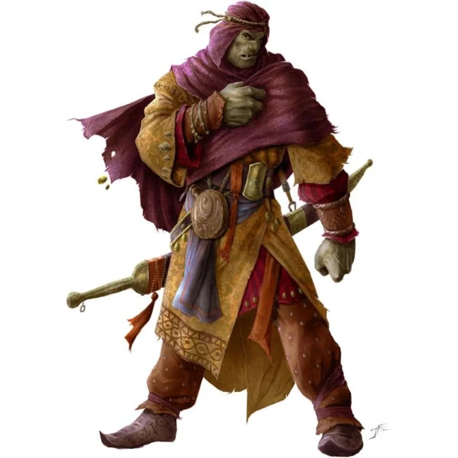

_Kupiec zaopatrujący Gniazdo._

Pół-ork, który działa jako pośrednik handlowy dla [[Gniazdo Zapomnianych]]. Sprzedaje wywary [[Jankas|Jankasa]] na powierzchni w zamian za niezbędne zaopatrzenie. Dzięki swojemu wyglądowi i statusowi może poruszać się po niektórych częściach miasta.
