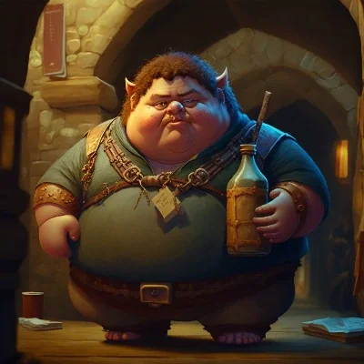

_Mędrzec z Wielkich Ogrodów, zwany "Vitalis Tłusty"._

## Opis
Vitalis, zwany Otyłym, to najmądrzejszy śmiertelnik w **[[Wielkie Ogrody|Wielkich Ogrodach]]**.

Jest niziołkiem, brudnym, grubym i śmierdzącym.

## Działalność
Udziela rad każdemu, kto nakarmi go dobrym jedzeniem lub winem. Jego rady są trafne, choć często poprzedzone obraźliwymi żartami i beknięciami.

## Historia
W [[Sesja 18 - Cienie Mytros]] [[Felicjan Janus Twardowski|Felicjan]] udał się do niego, by dowiedzieć się czegoś o Fortecy Smoczych Lordów. W zamian za smaczny posiłek Vitalis poradził mu, by do znalezienia Fortecy najpierw odnaleźć [[Talieus|Talieusa]].
