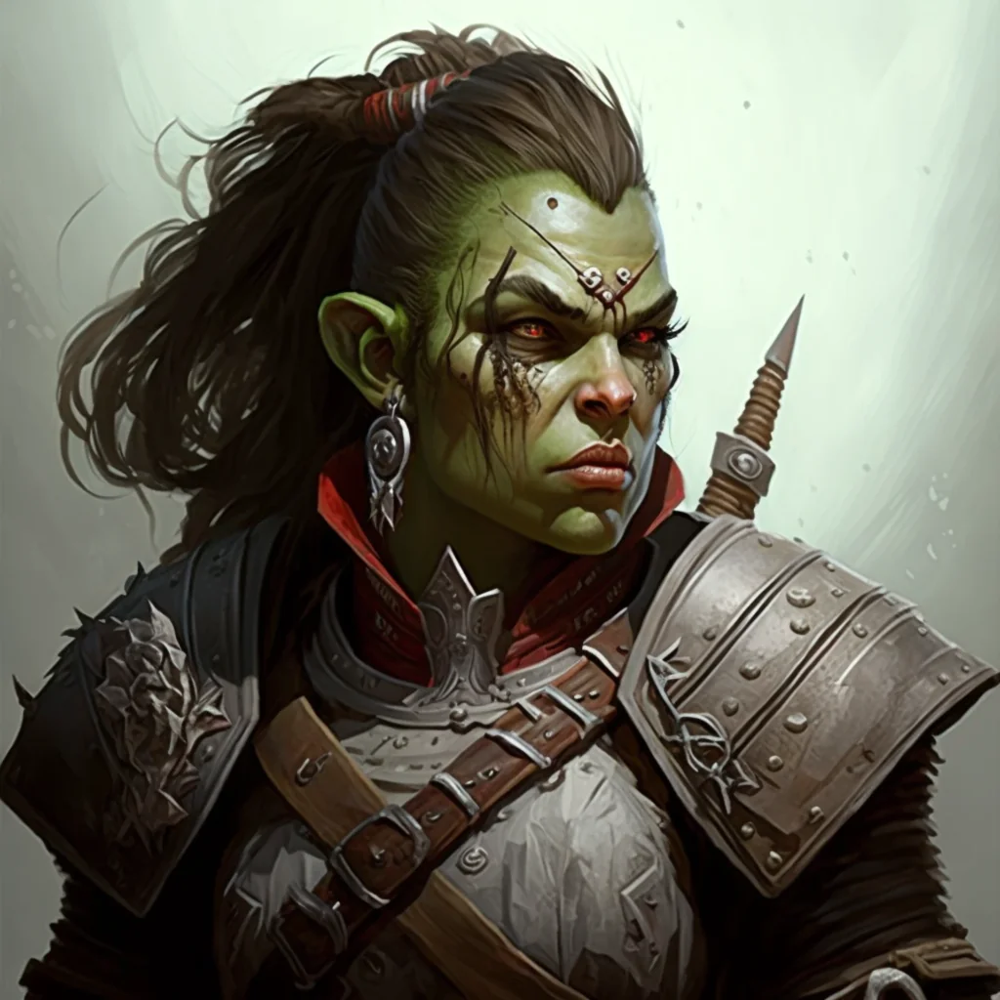

_Ochroniarka w Siren's Roost._

## Opis
Vorena to małomówna półorczyca i była centurionka. Pracuje dla **[[Ambrosia|Ambrozji]]** jako szefowa ochrony w **[[Syrenie Gniazdo|Syrenim Gnieździe]]**. Jest niezwykle skuteczna w swojej pracy i dba o bezpieczeństwo "pracowników" i gości.
