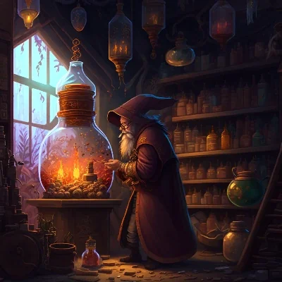

_Zgorzkniały alchemik._

## Opis
Zorin to gnom sprzedający mikstury.

Został wyrzucony z **[[Akademia Mytros|Akademii]]** (głównie za brak talentu oratorskiego i obrażanie innych). Prowadzi sklep alchemiczny **Zorin's Concoctions** na **[[Agora w Mytros|Agorze]]**. Sprzedaje mikstury i drobne magiczne przedmioty.

## Historia
W [[Sesja 19 - Pojedynek z Rozpruwaczem]] spotkał [[Orion Xul|Oriona]], oferując mu mikstury i Necklace of Adaptation za 900 sztuk złota.
