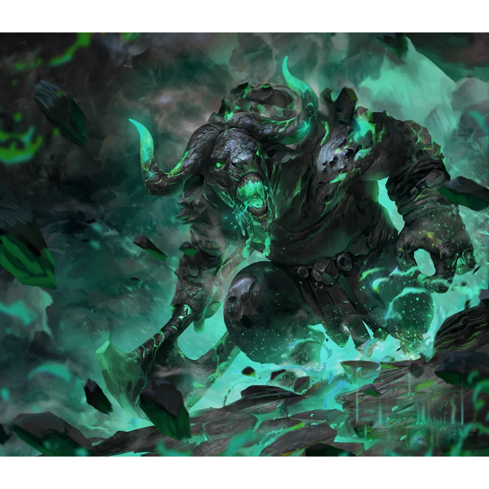

_Strażnik Grobowca Xandera, pokonany przez Bohaterów Przepowiedni._

## Opis
Graxis był potężnym minotaurem.

## Osobowość
Nienawidził [[Xander|Xandera]], [[Damon|Damona]] i wszystkich [[Smoczy Lordowie|Smoczych Lordów]]. Uważał Xandera za mordercę swojego ludu.

## Historia
Był ostatnim z klanu krwiożerczych minotaurów, plemienia stworzonego przez [[Lutheria|Lutherię]]. Kiedy [[Rizon Phobas]] pokonała jego lud, [[Damon]] rzucił klątwę na ocalałych, zmuszając ich do wiecznej służby jako strażników Nekropolii.

W [[Sesja 9 - W Głębi Grobowca Xandera]] bohaterowie, po przejściu przez [[Labirynt w Nekropolii|labirynt]] pełen nieumarłych minotaurów i walce ze szkieletami we wnętrzu [[Grobowiec Xandera|grobowca Xandera]], stanęli przed Graxisem — strażnikiem grobowca. Pokonali go, a dopiero wtedy ukazał się im sam [[Xander]].
