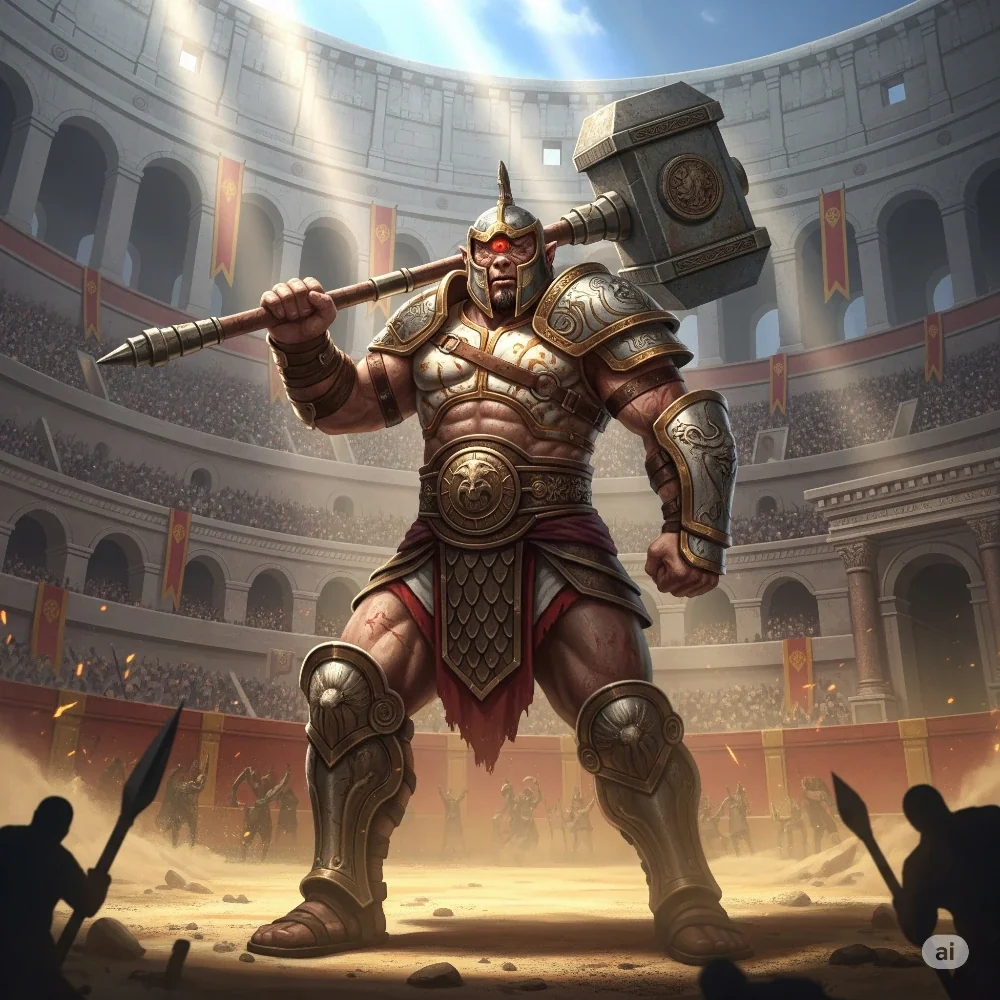

_Dowódca falangi cyklopów Heliosa._

## Opis
Potężny cyklop odziany w pancerz z kości słoniowej i brązu. Nosi wielki młot wojenny.

## Osobowość
Zdyscyplinowany, wojskowy, lojalny. Początkowo wrogi wobec bohaterów, których oskarżył o morderstwo [[Helios|Heliosa]], ale potrafi docenić dyplomację.

## Historia
W [[Sesja 58 - Wyspa Czasu]], po tym jak [[Furie]] zabrały [[Helios|Heliosa]] na wygnanie, dowodził zdyscyplinowaną falangą cyklopów, która z wojskową precyzją otoczyła bohaterów, oskarżając ich o morderstwo. Zanim doszło do walki, [[Versir]] podjął próbę dyplomacji i opowiedział o pakcie, jaki Helios zawarł z [[Sydon|Sydonem]]; słowa te potwierdził [[Tolyphemus]]. Cyklopy odstąpiły od walki i otworzyły przed bohaterami podziemny skarbiec swego pana, prosząc jedynie, by po wojnie spróbowano uwolnić Heliosa z Wyspy Złamanych Przysiąg.
