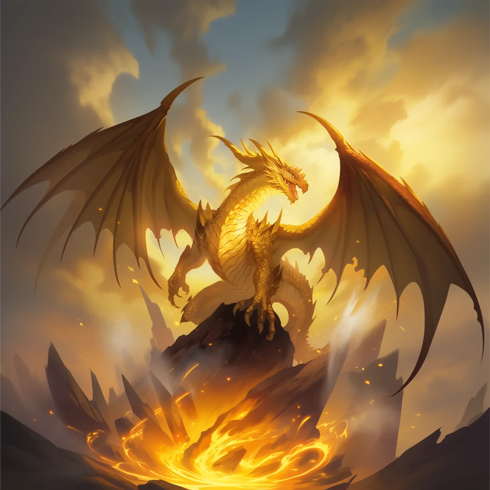

_Starożytne bóstwo słońca, ojciec cyklopów, zmuszony przez własną przysięgę do paktu z Sydonem; po wygnaniu i uwięzieniu, uwolniony z Wyspy Krzywoprzysięstwa po wygaśnięciu Przysięgi Pokoju, walczył w obronie Mytros._

## Opis
Helios objawia się jako mężczyzna o nieludzkiej urodzie, ubrany w lśniące, złote szaty; mieszka w rajskim ogrodzie na wyspie. Potrafi przybrać postać gigantycznego, starożytnego złotego smoka i zionąć ogniem.

Ma być wspaniałym, silnym mężczyzną, promieniującym złotem i oślepiającym blaskiem słońca, kojarzonym ze złotym rydwanem przemierzającym niebiosa.

## Osobowość
Dla swoich wyznawców, takich jak [[Euria]], Helios ucieleśnia perfekcyjne piękno i potęgę, wolną od brudu i słabości śmiertelnego świata.

W obliczu paktu z [[Sydon|Sydonem]] nie był sojusznikiem Tytana z wyboru, lecz ofiarą własnych zobowiązań; do ataku na gości zabrał się z żalem.

## Historia
Euria, Jesienny Wiatr, była zafascynowana Heliosem; bohaterowie spotkali ją w jego świątyni.

W [[Sesja 10 - Świątynia Heliosa i Jaskinie Troglodytów]] bohaterowie spotkali w jego [[Świątynia Heliosa|świątyni]] nimfę [[Euria|Eurię]], którą fascynował; doszło do walki i bohaterowie musieli ją zabić.

W [[Sesja 57 - Ogród Heliosa]] przyjął [[Bohaterowie Przepowiedni|Bohaterów Przepowiedni]] w swoim [[Ogród Heliosa|Ogrodzie]] na [[Zapomniane Morze|Zapomnianym Morzu]]: rajskim ogrodzie na wyspie, gdzie żył wraz z cyklopami, swoimi „dziećmi”. Wyznał, że został zmuszony do paktu z [[Sydon|Sydonem]] i przysiągł oddać mu cyklopy jako żołnierzy, by chronić ogród. Następnie, mówiąc „Wybaczcie mi to, co muszę teraz zrobić”, przybrał postać złotego smoka i zaatakował gości. Walka dobiegła końca, gdy interweniowały [[Megara|Megara]] i [[Furie]], które oskarżyły go o złamanie praw gościnności; pokonany i skuty, został przez nie skazany na wygnanie.

W [[Sesja 58 - Wyspa Czasu]] cyklopy pod wodzą [[Arges|Argesa]] i [[Tolyphemus|Tolyphemus]] wyjaśniły bohaterom, że Helios świadomie sprowokował ich, by ściągnąć gniew Furii i przez wygnanie ocalić swoje dzieci od paktu. Został zesłany na Wyspę Złamanych Przysiąg; cyklopy prosiły, by po wojnie spróbowano go uwolnić, i w zamian otworzyły bohaterom jego podziemny skarbiec, w którym znajdowały się m.in. [[Chariot of Dawn|rydwan]], Cube of Force, mikstura szybkości i [[Smoczy Talizman]].

W [[Sesja 68 - Arena Krzywoprzysięstwa]] bohaterowie znaleźli go spętanego łańcuchami przy centralnym filarze [[Wyspa Krzywoprzysięstwa|Wyspy Krzywoprzysięstwa]], pilnowanego jako „celebrytę”. Wyjawił im swój dylemat: uwolniony przed końcem [[Przysięga Pokoju|Przysięgi Pokoju]], byłby zmuszony przysięgą do wsparcia Tytana. Bohaterowie postanowili więc uwolnić go dopiero po jej wygaśnięciu, a [[The Warden|Zarządca]] zgodził się przymknąć oko na „jedną duszę” w zamian za widowisko na arenie. Zarządca dotrzymał umowy: gdy [[Przysięga Pokoju|Przysięga Pokoju]] wygasła, Helios został uwolniony z wyspy, choć stało się to w tle, bez udziału bohaterów.

W [[Sesja 83 - Zmierzch Ery Tytanów]] walczył po stronie obrońców [[Mytros]], krążąc nad polem bitwy w postaci złotego smoka i wypuszczając z paszczy fale ognia na [[Kentimane|Kentimane'a]]. Ramiona [[Tytani|Tytana]] oplotły go i przygwoździły w uścisku, z którego nie zdołał się wyrwać do końca starcia.

W [[Sesja 84 - Świt Nowej Ery]] nie upominał się już o zwrot [[Chariot of Dawn|rydwanu]] do swojego skarbca, a [[Furie]] nie przyszły po niego ponownie. Na jego wyspie zapanował spokój niemal absurdalny: cyklopy rozwinęły ruch pacyfistyczny i hipisowski.
