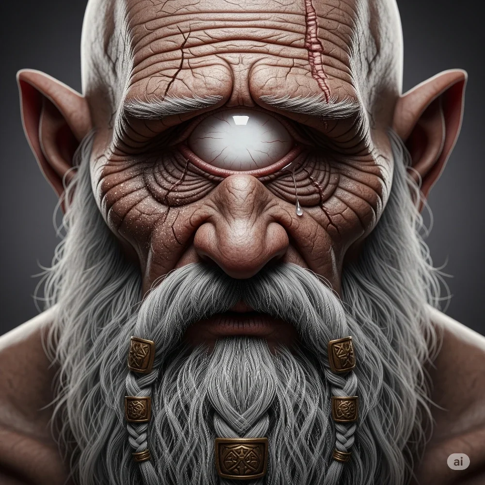

_Ślepy cyklop z [[Ogród Heliosa|Ogrodu Heliosa]], który usługiwał bohaterom podczas uczty._

## Opis
Starszy, ślepy cyklop.

## Osobowość
Nie lubi śmiertelników – został oślepiony przez ludzkich żeglarzy lata temu. Służy Heliosowi, ale nie jest mu bezgranicznie oddany: wie, że Helios nie jest bogiem.

## Historia
Służy Heliosowi jako zarządca i szef kuchni.

W [[Sesja 57 - Ogród Heliosa]] jako ślepy cyklop usługiwał bohaterom podczas uczty; gdy [[Helios]] przemienił się w złotego smoka, [[Versir]] chwycił go i zagroził jego śmiercią, jeśli smok nie zaprzestanie ataku.

W [[Sesja 58 - Wyspa Czasu]] — po wygnaniu Heliosa przez [[Furie]] — potwierdził przed bohaterami i cyklopami [[Arges|Argesa]] pakt swojego pana z [[Sydon|Sydonem]]: ich „ojciec”, nie mogąc złamać danego słowa, świadomie sprowokował bohaterów, by ściągnąć na siebie gniew Furii i poprzez własne wygnanie ocalić swoje dzieci. Dzięki temu cyklopy otworzyły bohaterom skarbiec Heliosa.
