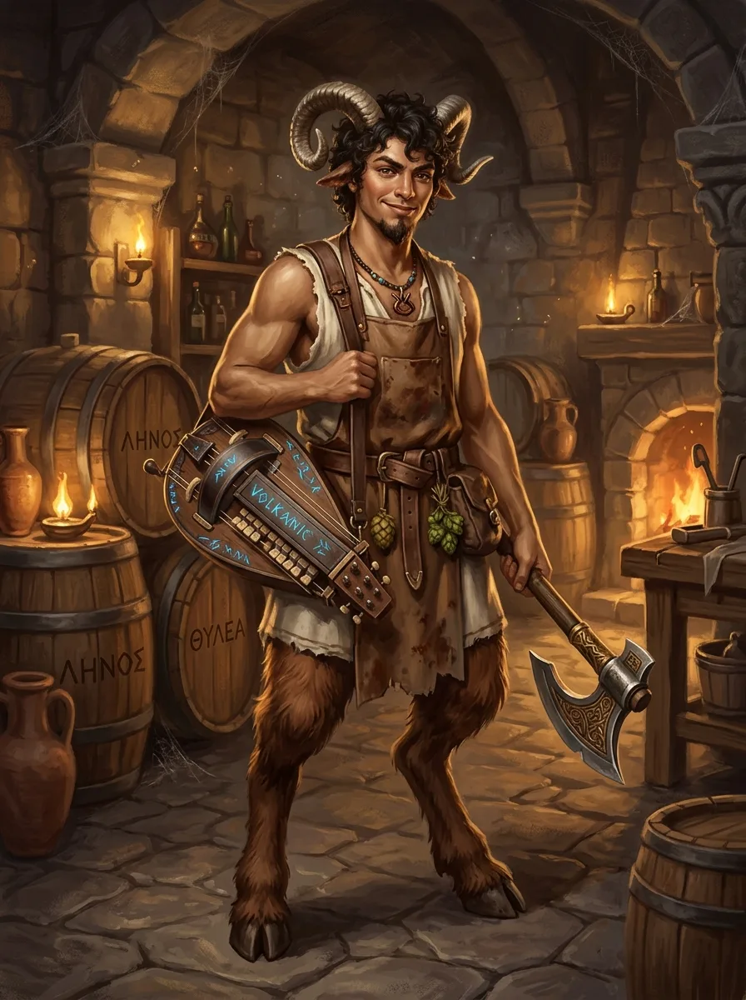

_Daleki kuzyn i uczeń [[Orestes|Orestesa]], piwowar z [[Orestessos Zythikē]]; od niedawna zaginiony._

## Opis
Młody satyr o kręconych czarnych włosach i zakręconych rogach, w poplamionym fartuchu piwowara, z szyszkami chmielu u pasa. Nosi przy sobie topór i lirę korbową, którą zrobił mu [[Volkan]].

## Osobowość
Pomysłowy piwowar, który nie boi się łączyć tradycji: to on wpadł na piwo jęczmienne leżakowane w beczkach po winie.

## Historia
Kuzyn [[Orestes|Orestesa]] — według samego Orestesa „piąta woda po kisielu" — z dalekich krewnych, o których minotaur prawie nie słyszał. Przedstawił go Orestesowi [[Silenos|Wujaszek]].

Szacunek rodziny zyskał, wymyślając rewolucyjne piwo jęczmienne leżakowane w beczkach po winie. Orestes wziął go wtedy pod skrzydła i uczy go trzech najważniejszych rzeczy w życiu: perfekcyjnego piwowarstwa, machania toporem i gry na lirze korbowej. Do leżakowania używa beczek przejętych z upadających winnic.

W [[Sesja 85 - Cienie nad Arezją]], jako osiemnastolatek, wyjechał do [[Mytros]], gdzie na [[Ultros|Ultrosie]] praktykował [[Zythion]]. Przez pierwsze dwa tygodnie wszystko układało się dobrze, potem zaczął chodzić sfrustrowany. Narzekał na [[Taran Neurdagon|Tarana Neurdagona]] i powtarzał, że w Thylei satyr nalewa, minotaur dźwiga, a ludzie ciągną zyski, podczas gdy rasy fey żyją z ludzkiej łaski. Wspominał o kimś na półwyspie na wschodzie, kto wziął sprawy w swoje ręce, by naprostować historyczne krzywdy, a potem zniknął. Zythion obawia się, że satyr wyruszył właśnie tam; Orestes zapowiedział, że sprowadzi go z powrotem. Na święcie browaru w [[Orestessos Zythikē]] reprezentacyjna beczka jego ciemnego piwa leżakowanego po winie okazała się skwaszona winnym octem, co Orestes uznał za sabotaż winiarzy z [[Arezja|Arezji]].
