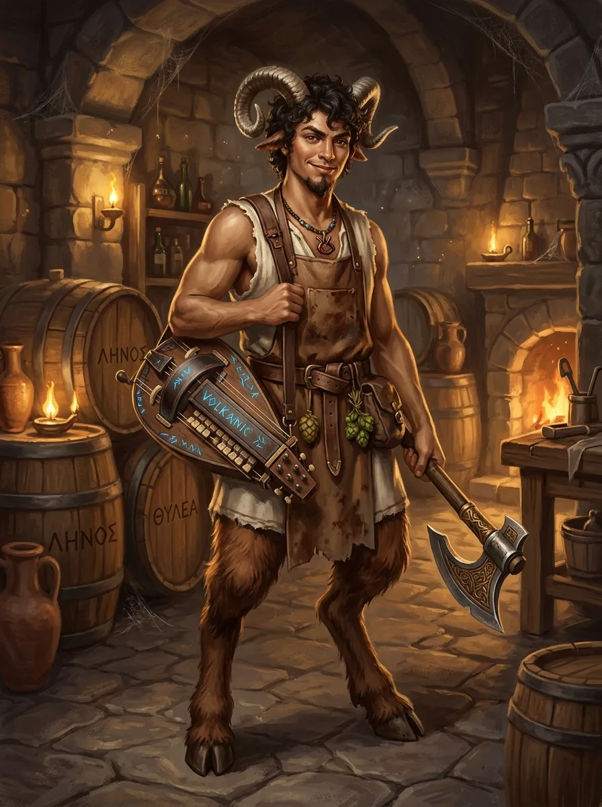

_Daleki kuzyn i uczeń [[Orestes|Orestesa]], piwowar z [[Orestessos Zythikē]]._

## Opis
Młody satyr o kręconych czarnych włosach i zakręconych rogach, w poplamionym fartuchu piwowara, z szyszkami chmielu u pasa. Nosi przy sobie topór i keyboard.

## Osobowość
Pomysłowy piwowar, który nie boi się łączyć tradycji: to on wpadł na piwo jęczmienne leżakowane w beczkach po winie.

## Historia
Kuzyn [[Orestes|Orestesa]] — według samego Orestesa „piąta woda po kisielu" — z dalekich krewnych, o których minotaur prawie nie słyszał. Przedstawił go Orestesowi [[Silenos|Wujaszek]].

Szacunek rodziny zyskał, wymyślając rewolucyjne piwo jęczmienne leżakowane w beczkach po winie. Orestes wziął go wtedy pod skrzydła i uczy go trzech najważniejszych rzeczy w życiu: perfekcyjnego piwowarstwa, machania toporem i gry na keyboardzie.
