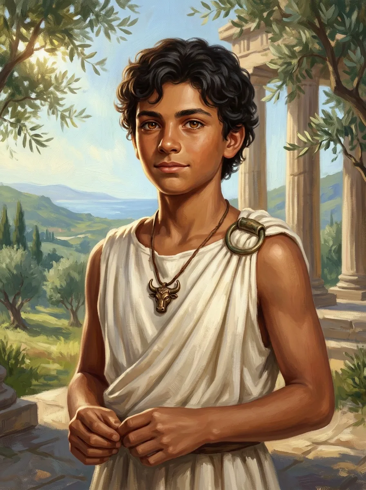

_Nieślubny syn [[Orestes|Orestesa]] i Amazonki [[Alkippe]], wychowany w browarze w [[Orestessos Zythikē]]._

## Opis
Chłopak o kręconych czarnych włosach i ciepłych brązowych oczach. Po ojcu odziedziczył potężną, muskularną budowę, ale fizycznie jest człowiekiem, jak matka, i nie ma rogów. Jako dwunastolatek dźwiga już piętnastolitrowe beczki. Na szyi nosi brązowy wisiorek z głową byka.

Jego imię pochodzi z greckiego i znaczy „Zrodzony przy piwie".

## Historia
Syn [[Orestes|Orestesa]] i Amazonki [[Alkippe]], którzy zeszli się podczas walk o [[Mytros]]. Po wykarmieniu syna matka wróciła na [[Themis]], a chłopca wychowuje Orestes w swoim browarze w [[Orestessos Zythikē]] ([[Sesja 85 - Cienie nad Arezją]]).

W [[Sesja 85 - Cienie nad Arezją]] odbywał praktyki u [[Brax|Braxa]] w [[Mytros]] i stał za szynkiem na [[Ultros|Ultrosie]]. Opowiedział ojcu o nieudanym włamaniu do kajuty kapitańskiej i o ranach [[Kalistor|Kalistora]]. Przyciśnięty, wyznał też, co stało się z [[Krithon|Krithonem]]: satyr narzekał na [[Taran Neurdagon|Tarana Neurdagona]] i na los ras fey, wspominał o kimś na półwyspie na wschodzie, kto wziął sprawy w swoje ręce, a potem zniknął. Zythion obawia się, że Krithon wyruszył właśnie tam. Orestes kazał mu dalej polewać piwo.
