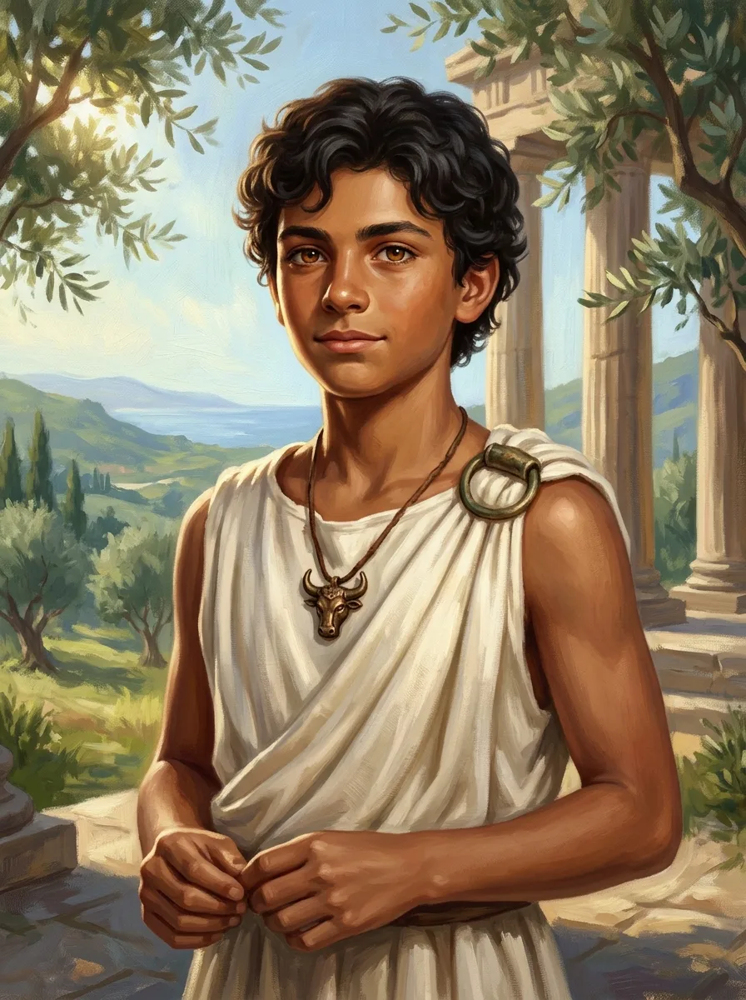

_Nieślubny syn [[Orestes|Orestesa]] i Amazonki [[Alkippe]], wychowany w browarze w [[Orestessos Zythikē]]._

## Opis
Chłopak o kręconych czarnych włosach i ciepłych brązowych oczach. Po ojcu odziedziczył potężną, muskularną budowę, ale fizycznie jest człowiekiem, jak matka. Na szyi nosi brązowy wisiorek z głową byka.

Jego imię pochodzi z greckiego i znaczy „Zrodzony przy piwie".

## Historia
Owoc romansu [[Orestes|Orestesa]] z Amazonką [[Alkippe]]. Matka nie zamieszkała w mieście — jak to Amazonka, poszła własną drogą — więc Orestes wychowuje syna sam, w swoim browarze w [[Orestessos Zythikē]].
