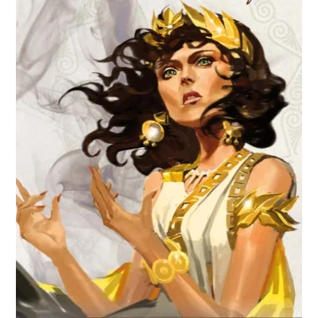

_Królowa Mytros, dawna Bogini Mądrości i jedna z bóstw Piątki; w rzeczywistości brązowa smoczyca [[Tysophale]]. Po abdykacji męża, [[Acastus|Acastusa]], przejęła koronę i rządzi miastem wraz z coraz ważniejszą radą._

## Opis
Królowa Mytros, bogini mądrości i najstarsza córka [[Mytros (Bogini)|Mytros]].
Niegdyś podróżowała daleko, badając ruiny i zbierając wiedzę.
Jest siostrą [[Kyrah]] i dzieckiem [[Balmytria|Balmytrii]], które otrzymało moc tytanów ([[Sesja 75 - Koniec Przysięgi]]); jest w miarę spokrewniona z [[Orion Xul|Orionem]] ([[Sesja 84 - Świt Nowej Ery]]). Na Igrzyskach nosiła szaty z błyszczącego błękitu i srebra.

## Osobowość
*   **Próżna:** Nigdy nie pokazuje się bez wykwintnych insygniów królewskich i przegląda się w srebrnym zwierciadle. Rozumie wagę pozorów w polityce.
*   **Bystra:** Niezwykle spostrzegawcza, podejrzewana o czytanie w myślach. Rozpoznaje kłamstwo i wymusza prawdę spojrzeniem.
*   **Pogardliwa wobec męża:** Nazywała [[Egida Mytros|Egidę Mytros]] pomnikiem pychy Acastusa i nie kryła pogardy dla jego „zabawek” ([[Sesja 55 - Egida Mytros]]).

"Arogancja może dotknąć nawet bardzo mądrych. Wierzcie mi — poślubiłam Acastusa."

## Historia
Jedna z bogiń Piątki ([[Sesja 75 - Koniec Przysięgi]]), żona Acastusa i władczyni Mytros ([[Sesja 30 - Zakończenie Igrzysk]]). Małżeństwo polityczne z 478 CE, nienawidzą się. Działa blisko z kapłanami, by podtrzymać wiarę w Piątkę.

W [[Sesja 13 - Wezwani przez Króla]] wraz z siostrą [[Kyrah]] twierdziła, że może powstrzymać burzę, jeśli uda się odzyskać instrumenty Notos. W [[Sesja 14 - Burza nad Mytros]] pomogła w rytuale powstrzymania burzy. Wyznała, że żałuje małżeństwa z [[Acastus|Acastusem]], zdradziła, że na [[Wyspa Yonder|Yonder]] jest starożytna biblioteka, która może pomóc Arevonowi znaleźć drogę do domu, i zleciła bohaterom zadania poboczne, w tym oczyszczenie Mytros z korupcji i rozwiązanie problemu targu niewolników.

W [[Sesja 16 - Świątynia Lutherii]] rozmawiała z drużyną o sytuacji w kanałach i obecności chimery w świątyni Lutherii. W [[Sesja 17 - Targ Minotaurów]] przybyła na spotkanie w Świątyni Pięciu, przyprowadzona przez [[Hoobert|Hooberta]]. W [[Sesja 20 - Noc Długich Rogów]] uczestniczyła w naradzie rady, po której drużyna uzyskała u niej audiencję.

W [[Sesja 22 - Taniec z Meduzą]] przyjęła pod swoją opiekę [[Nera|Nerę]] i [[Greciosa|Greciosę]], obiecując chronić je przed gniewem [[Acastus|Acastusa]].

W [[Sesja 23 - Nowe Przymierze]] została poinformowana przez drużynę o zażegnaniu zagrożenia ze strony Moxeny. Zgodziła się zlokalizować [[Varkon|Varkona]], który mógł posiadać [[Antikythera|Antikytherę]].

W [[Sesja 25 - Inauguracja Wielkich Igrzysk]] wygłosiła mowę otwierającą Igrzyska, niosąc pochodnię, i wyraziła obawy o los [[Kyrah]]. W [[Sesja 30 - Zakończenie Igrzysk]] zatańczyła z [[Orestes|Orestesem]] na uczcie u Tarana, poinformowała drużynę, że plany Antikythery powinny być w pałacu, ale doszło do włamania, i zgasiła święty ogień podczas ceremonii zakończenia. W [[Sesja 31 - Wyprawa na Themis]] udzieliła drużynie błogosławieństwa i przekazała dary od mieszkańców Mytros.

W [[Sesja 55 - Egida Mytros]], podczas nieobecności bohaterów, pozostała obrończynią Mytros i okazała się ich prawdziwą sojuszniczką. Chłodno powitała [[Idylla|Idyllę]], matkę Acastusa; pobladła na widok konspektu Sydona i przyznała, że przez wieki walczono z wrogiem, którego natury w pełni nie rozumiano. Opowiedziała [[Felicjan Janus Twardowski|Felicjanowi]], że smoki są partnerami i przyjaciółmi Smoczych Lordów, nie tylko narzędziem wojny, i ostrzegła bohaterów przed publicznym upokorzeniem szykowanym przez Acastusa.

W [[Sesja 83 - Zmierzch Ery Tytanów]] z niechęcią przyznała, że przywrócić Orestesa do życia mogłyby chyba tylko [[Mojry]].

W [[Sesja 84 - Świt Nowej Ery]] przejęła koronę [[Mytros]] po abdykacji [[Acastus|Acastusa]], czekając na niego wcześniej w sali narad nad stosem dokumentów. Rządziła przez kolejne piętnaście lat, stopniowo oddając coraz więcej obowiązków radzie, której znaczenie z każdym rokiem rosło — ale samego miasta nigdy nie opuściła. W drużynie żartowano nawet, kto z nich mógłby się z nią ożenić i rozwiązać problem sukcesji; nikt się nie zgłosił.

## Prawdziwa tożsamość: Tysophale
W [[Sesja 75 - Koniec Przysięgi]] wyszło na jaw, że **bogowie Thylei są smokami**. Vallus jest w rzeczywistości **[[Tysophale]]** — brązową smoczycą.

Niegdyś była wierzchowcem [[Telamok Arkelander|Telamoka Arkelandera]], uznana po Pierwszej Wojnie za zaginioną. Nie zaginęła: przez cały ten czas siedziała na tronie [[Mytros]].

Tajemnicę utrzymywała klauzula wpisana w [[Przysięga Pokoju|Przysięgę Pokoju]]: smocze pochodzenie Nowych Bogów oraz źródło ich boskich domen miały pozostać w ukryciu, a wraz z wygaśnięciem Przysięgi bogowie mieli zwrócić skradzione portfolio. Domeny nigdy nie należały do nich — wykradła je Tytanom srebrna smoczyca [[Balmytria]], przegrywając celowo siódmą partię Królewskiej Gry i płacąc stawkę własnym życiem ([[09 Gra Bogów|Gra Bogów]]).

Gdy [[Felicjan Janus Twardowski|Felicjan]] wypowiedział treść klauzuli na głos, Przysięga pękła, a domeny wróciły do [[Sydon|Sydona]] i [[Lutheria|Lutherii]]. Od tej pory Vallus prowadziła obronę stolicy jako [[Tysophale]] — w [[Sesja 76 - Bitwa o Mytros: Pierwsza Fala]] wylądowała na pokładzie [[Ultros|Ultrosa]] w smoczej postaci i przemieniła się w humanoidalną, by zdać drużynie raport z płonącego miasta (tsunami uderzyło w dolne dzielnice i doki, lecz większość cywilów ewakuowano), a w [[Sesja 77 - Bitwa o Mytros: Upadek Icarusa]] nurkowała na zmutowanego [[Icarus|Icarusa]] wraz z [[Raspytrion|Raspytrionem]]. Odtąd jest smoczycą, nie boginią.

**Drużyna postanowiła nie ujawniać tego publicznie.** Dla mieszkańców Thylei Vallus pozostaje Boginią Mądrości i królową [[Mytros]].
