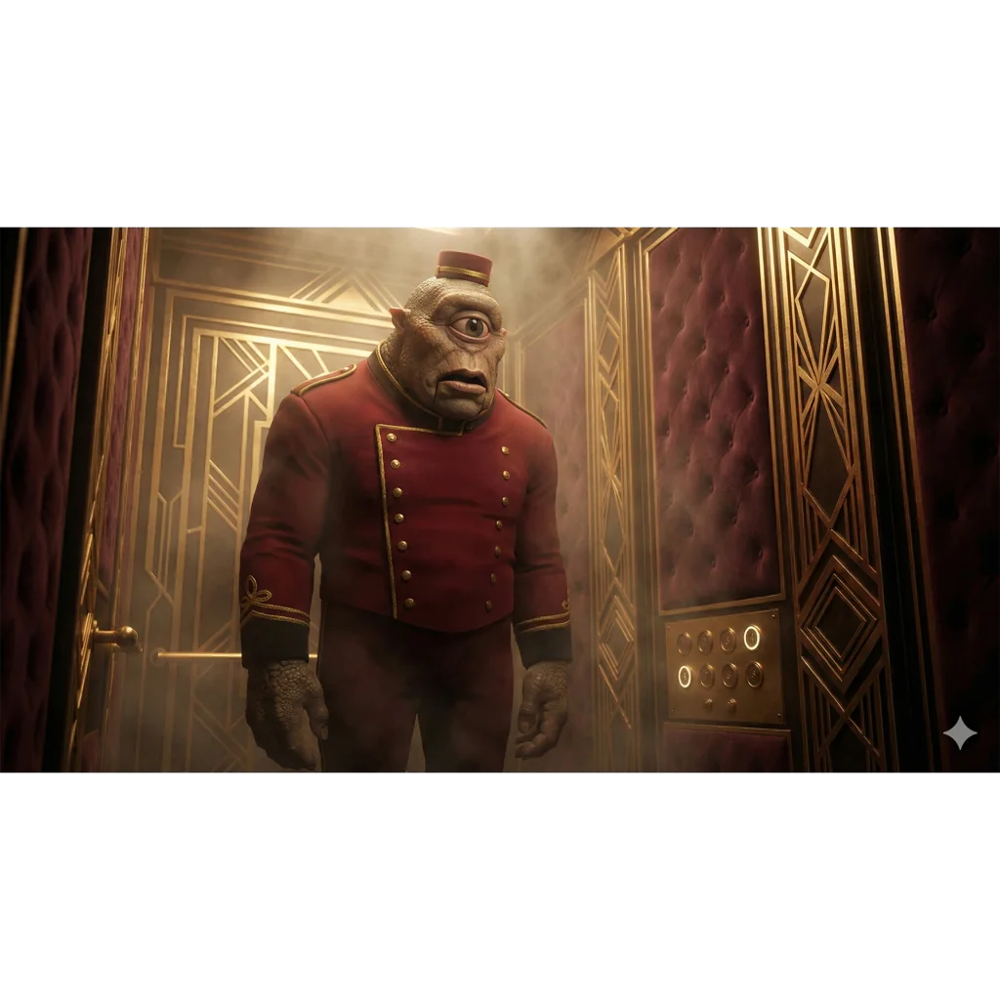

_Obsługa windy_

## Opis
Pracownik w wieży [[Praxys]], obsługiwał windę.

## Osobowość
TBD

## Historia
W [[Sesja 75 - Koniec Przysięgi]] został uwolniony przez bohaterów i załadowany na statek wraz z pozostałymi uwolnionymi więźniami z Praxys; statek odpłynął na bezpieczną odległość, a wieża została zniszczona.
