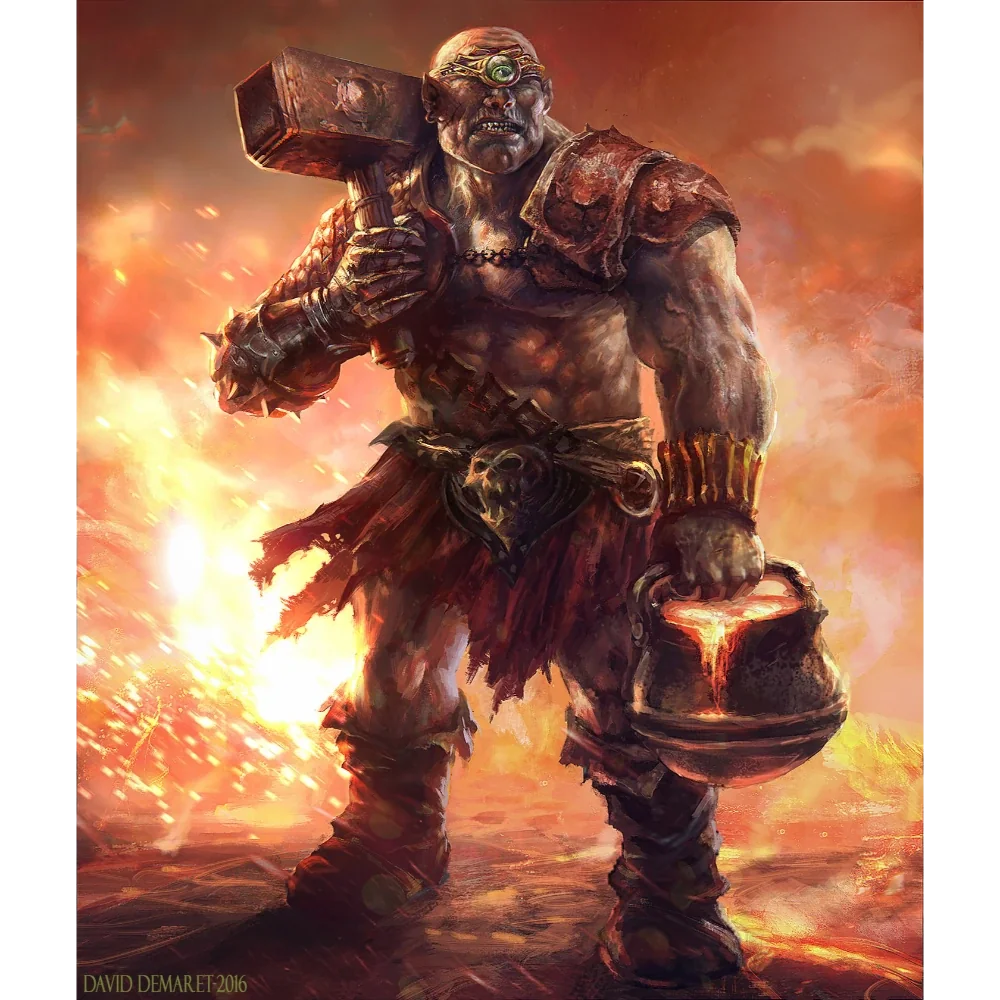

_Cyklop, strażnik kuźni w Praxys, zabity przez Orestesa._

## Opis
Cyklop z jednym, podejrzliwym okiem, dzierżący potężny kowalski młot.

## Historia
Strażnik kuźni w [[Praxys]], w której leżały truchła [[Myrmeki|myrmeków]].

W [[Sesja 72 - Śniadanie u Tytana Bochenek Przeznaczenia]] spotkał [[Bohaterowie Przepowiedni|Bohaterów Przepowiedni]]. [[Versir]] próbował przekonać go, że owady się zbuntowały, a drużyna została wysłana, by posprzątać bałagan, lecz nieufny strażnik postanowił podnieść alarm. Otworzył drzwi kuźni, sięgnął po wielką złotą monetę z wygrawerowanym czerwonym okiem — przypominającą artefakt noszony niegdyś przez [[Talieus Pierwszy|Talieusa]] — i uniósł ją w geście autoryzacji, pchając ciężkie wrota. Zanim zdążył ruszyć w stronę schodów, został zabity przez [[Orestes|Orestesa]], który wbił mu topór w potylicę. Minotaur ułożył zwłoki w groteskowej pozie na grzbiecie wielkiego, mechanicznego byka. Gdy bohaterowie pociągnęli za dźwignię i uruchomili pułapkę, truchło zsunęło się w lawę i spłonęło.
