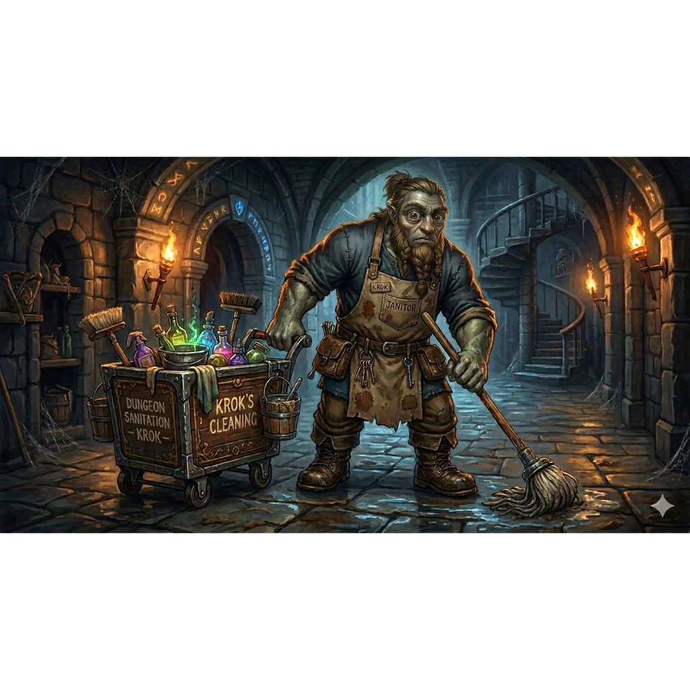

_Cyklop-Sprzątacz_

## Opis
Dwuoki cyklop, wyjątkowo zdeformowany, gdyż — ku powszechnemu zaskoczeniu — ma dwoje oczu. Dba o czystość marmurowej latryny w [[Praxys]].

Ubolewa nad swoją paskudną deformacją.

## Historia
Pracował w [[Praxys]]. W [[Sesja 71 - Infiltracja Praxys]] bohaterowie wynurzyli się z kanałów prosto w jego latrynie. Zanim Krok zorientował się w sytuacji, zaczął kwestionować dźwięki dochodzące z kabiny, ale [[Orion Xul|Orion]] zaczął głośno jęczeć i odgrywać problemy żołądkowe, a [[Felicjan Janus Twardowski|Felicjan]] dopełnił szaradę potężną iluzją dźwiękową niekontrolowanej biegunki. Gdy Orion zażądał jeszcze papieru toaletowego i kazał mu pójść zjeść kanapkę, zdezorientowany cyklop w popłochu oddalił się z latryny w poszukiwaniu kanapki, unikając konfliktu.

W [[Sesja 75 - Koniec Przysięgi]] został uwolniony jako więzień Praxys i załadowany na statek, który odpłynął na bezpieczną odległość.
