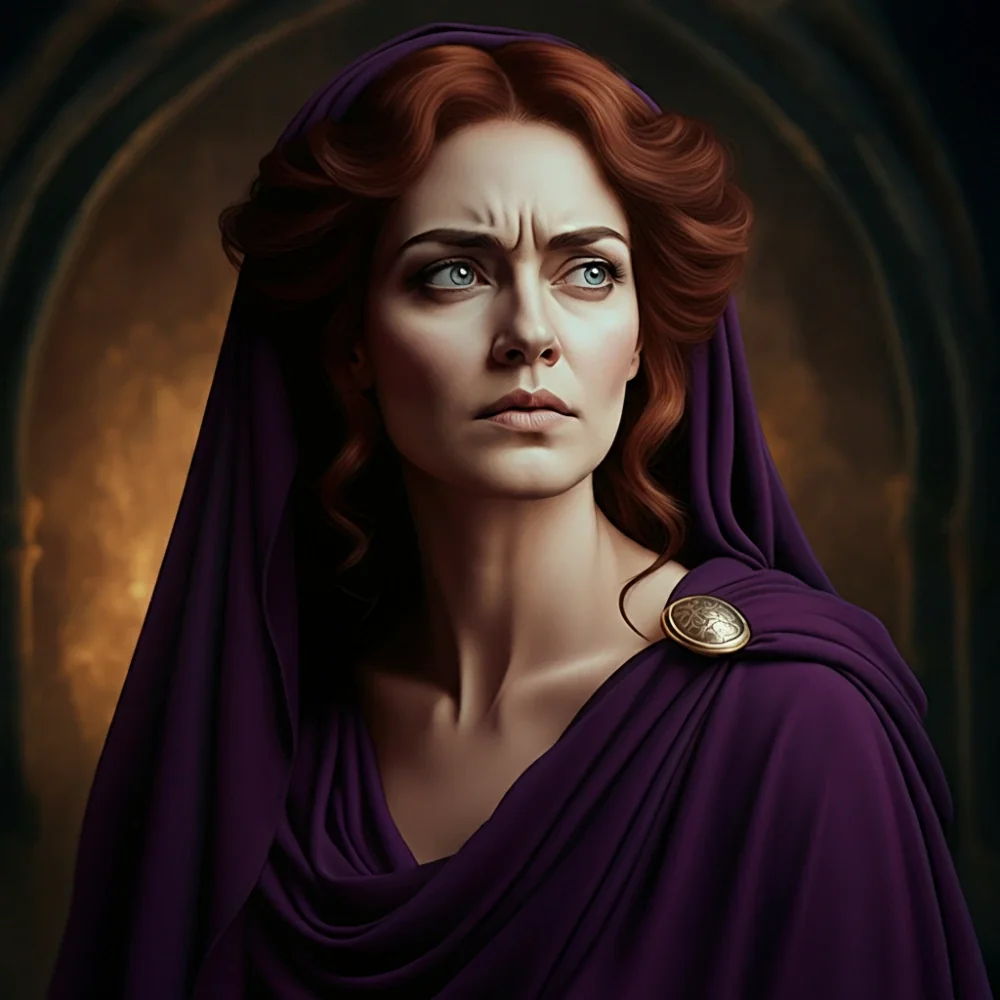

_Czarodziejka z załogi Quinna, rozbitek z innego świata na pokładzie Ultrosa._

Członkini załogi statku "Sen Kasandry", towarzyszka [[Quinn|Quinna]].

## Opis
Upiera się przy noszeniu szat ozdobionych piórami. Gdy zobaczyła gwiazdy nad [[Thylea|Thyleą]], stwierdziła, że to jakiś inny świat.

## Osobowość
Ciekawska, zadaje mnóstwo pytań.

## Historia
Zwerbowana przez [[Quinn|Quinna]] do ekspedycji. Przeżyła katastrofę statku.

W [[Sesja 36 - Królowa, Dziedzic i Generał]] została uratowana z wraku wraz z Quinnem i resztą rozbitków i wcielona do załogi [[Ultros|Ultrosa]] — zmuszono ją do wiosłowania pod pokładem.
