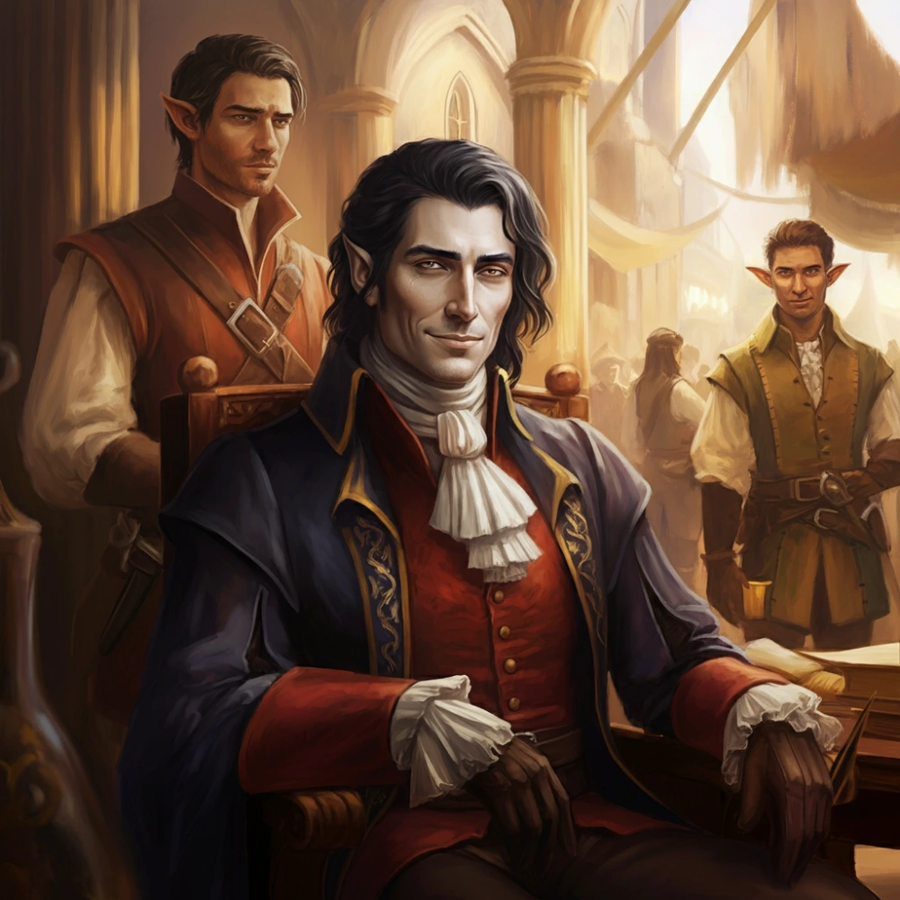

_Samozwańczy dziedzic Szmaragdowej Doliny, syn Barona Alarica; rozbitek z innego świata na pokładzie Ultrosa._

## Opis
Ubrany w łachmany i wodorosty, ale zachowujący pozory wielkiego pana.

## Osobowość
Próżny, narcystyczny, pozornie nieświadomy powagi swojej sytuacji. Obraził niemal wszystkich przy pierwszej rozmowie z drużyną.

## Historia
Członek załogi Kasandry, uczestnik ekspedycji po zaginione artefakty; ich statek, "Sen Kasandry", został wciągnięty przez wir, który wypluł go na wody Thylei, i zniszczony przez kolosalnego wielorękiego potwora.

W [[Sesja 36 - Królowa, Dziedzic i Generał]] [[Arevon Elorrenthi|Arevon]] dostrzegł na horyzoncie wrak statku z rozbitkami: Quinnem, łotrzykiem [[Dengran|Dengranem]], czarodziejką [[Heliope]] i krasnoludem [[Rutger|Rutgerem]]. Przedstawił się jako syn barona Alarica i prawowity dziedzic Szmaragdowej Doliny, po czym obraził niemal wszystkich; rozbitkowie zostali wcieleni do załogi [[Ultros|Ultrosa]] i zmuszeni do wiosłowania pod pokładem.
