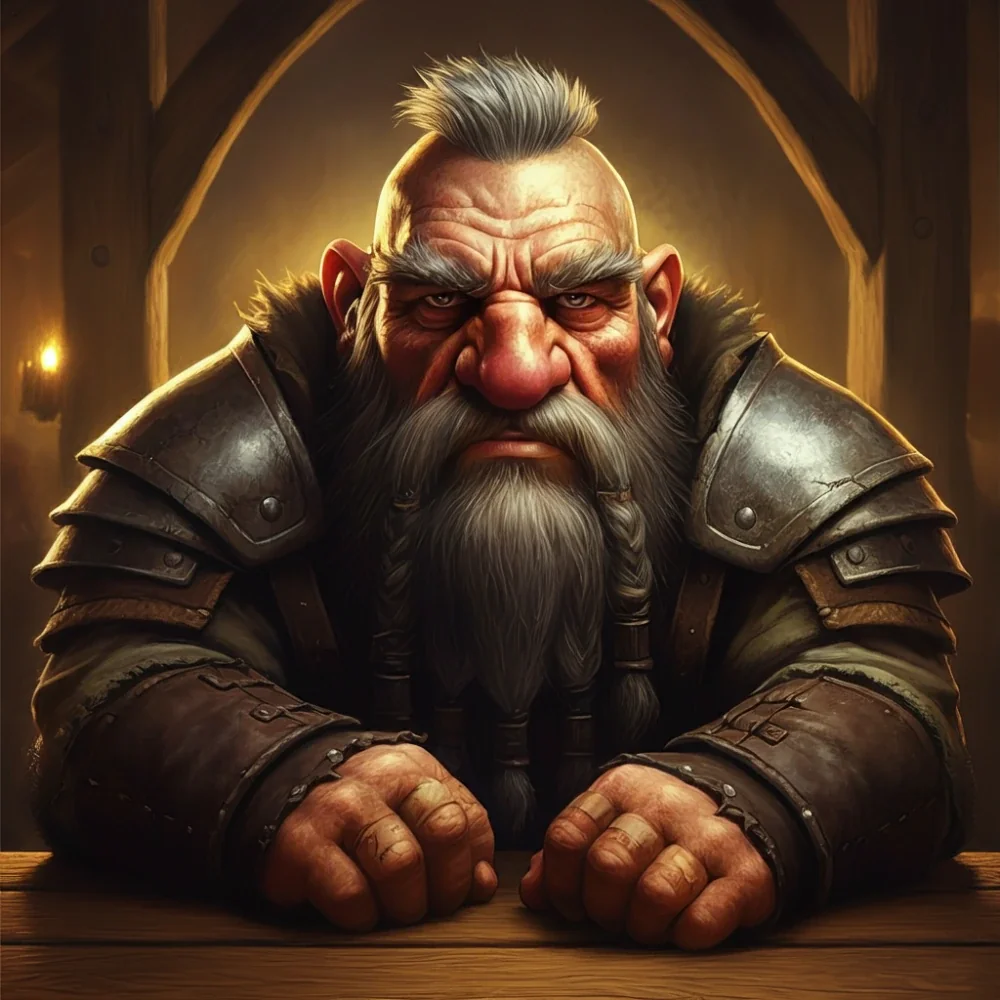

_Krasnolud z załogi Quinna, rozbitek z innego świata na pokładzie Ultrosa._

Członek załogi statku "Sen Kasandry", towarzysz [[Quinn|Quinna]].

## Opis
Według [[Quinn|Quinna]] "mruczy więcej niż mówi i wiecznie śmierdzi piwem".

## Historia
Zwerbowany przez Quinna do ekspedycji. Przeżył katastrofę statku.

W [[Sesja 36 - Królowa, Dziedzic i Generał]] został uratowany z wraku wraz z Quinnem i resztą rozbitków i wcielony do załogi [[Ultros|Ultrosa]] — zmuszono go do wiosłowania pod pokładem.
