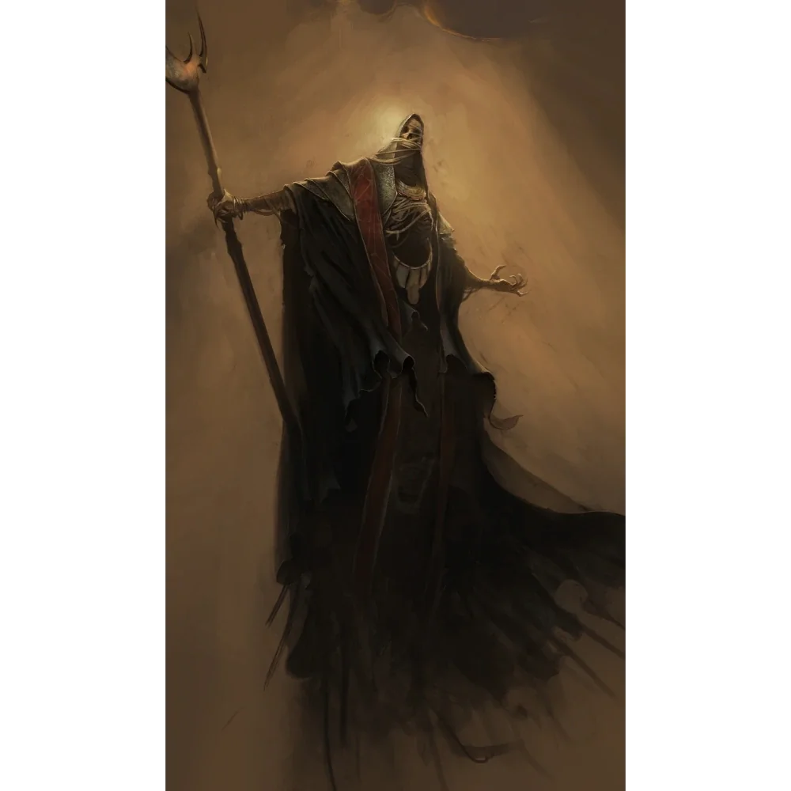

_Strażnik [[Nekropolia w Telamok|Nekropolii w Telamok]]._

## Opis
Wielki czarodziej Smoczych Lordów, założyciel [[Akademia Mytros|Akademii Mytros]]. Był potężnym czarodziejem, który służył Smoczym Lordom podczas Pierwszej Wojny.

## Historia
Gdy Smoczy Lordowie wyruszyli w swoją ostatnią podróż na Zapomniane Morze, kapłani wypatrywali zagłady. Jednak pewnej nocy wzburzone morze uspokoiło się, a koszmary ustały. Kilka dni później, do portu w Mytros wpłynął czarny statek z ciałami Smoczych Lordów. Kapitanem był Damon, śmiertelnie ranny i milczący.

Przekazał trzy cenne przedmioty do Świątyni Pięciu, w tym zwój z Przysięgą Pokoju (Oath of Peace). Przysięga ta powstrzymała [[Bliźniaczy Tytani|Bliźniaczych Tytanów]] przed zemstą na 500 lat, pod warunkiem wznowienia ofiar. Po spełnieniu zadania, Damon zniknął wraz ze swoim statkiem i ciałami swoich towarzyszy.
Założył również Akademię w Mytros, centrum wiedzy i magii.

W wizji [[Podbój Estora]], którą [[Arevon Elorrenthi|Arevon]] przeżył w [[Sesja 36 - Królowa, Dziedzic i Generał]], Damon doradzał Estorowi, jak zdobyć twierdzę wroga: wykorzystać pustą w środku statuę [[Sydon|Sydona]] do przemycenia oddziału, który nocą sabotuje katapulty.

W [[Sesja 8 - Ścieżka Umarłych]] bohaterowie, niosąc dla niego [[Burnished Dragonlord Coin]], spotkali go jako tajemniczego strażnika [[Nekropolia w Telamok|Nekropolii]]. W [[Sesja 9 - W Głębi Grobowca Xandera]] po wyjściu z grobowca przekazał Arevonowi artefakt, z pomocą którego ten doświadczył wizji związanej z [[Zakład Smoczego Lorda|Zakładem Smoczego Lorda]]. W [[Sesja 56 - Dedal i Ikar]] artefakt otrzymany od Damona wywoływał u Arevona wizje [[Hexia|Hexii]].
