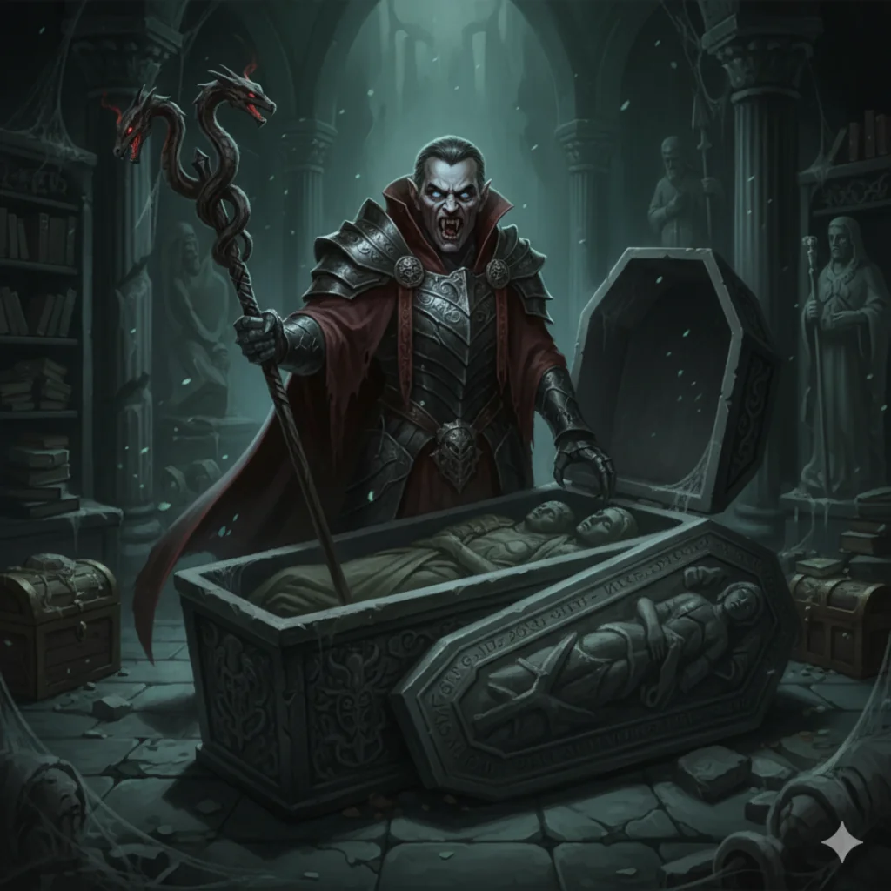

_Smoczy Lord zwany Wilczym Lordem, pierwszy i jedyny król Arezji, zdrajca Smoczych Lordów_

## Historia
Dosiadał czerwonego smoka [[Zarmulax]]. Ukradł [[Kaduceusz Damona]] i zabił nim [[Xander|Xandera]].

Dowódca smoczych jeźdźców, który zdradził [[Smoczy Lordowie|Smoczych Lordów]]. Zamordował [[Xander|Xandera]], pierwszego przywódcę Smoczych Lordów, a [[Narsus]], bóg piękna, który się z nim sprzymierzył, pomógł mu w ucieczce. Zawarł pakt z [[Lutheria|Lutherią]], założył [[Arezja|Arezję]] i został jej pierwszym i jedynym królem. Jego córka, królowa [[Calliope]], porwała później [[Damon|Damona]] i zamknęła go w złotej klatce. Tę historię [[Pythor]] i [[Kyrah]] opowiedzieli bohaterom w [[Sesja 61 - Yala, Arezja i Żółw]].

W [[Sesja 62 - Arezyjska Dyplomacja]] bohaterowie widzieli w Galerii Sztuki jego [[Portret Karpathosa|zaczarowany portret]], który emanował magią transmutacji i nekromancji; plotki głosiły, że uwięziona jest w nim dusza samego króla.

W [[Sesja 63 - Werdykt Arezji]] [[Felicjan Janus Twardowski|Felicjan]] odkrył zaklęciem identyfikacji, że obraz jest filakterium z esencją potężnego nieumarłego, prawdopodobnie samego króla-założyciela. Drużyna kupiła go za 50 000 sztuk złota.

W [[Sesja 69 - Ogród Lutherii]] w Sali Wróżenia lustro pokazało go na wzgórzu z bramą strzeżoną przez dwóch wojowników w arezyjskich zbrojach.

W [[Sesja 86 - Trzy Klucze Teogenezy]] [[Narsus]] wyjawił, że [[Kaduceusz Damona]], jeden z przedmiotów potrzebnych do [[Magia Thylei#Theogenesis (Apoteoza)|Teogenezy]], spoczywa razem z Karpathosem w [[Kurhany Karpathosa|kurhanach]]. [[Królowa Helena]] opowiedziała, że gdy [[Lutheria]] przeklęła go wampiryzmem, zaczął przemieniać rodzinę i strażników w swoje sługi, a jego córka [[Calliope]] zwabiła go do kurhanów i zapieczętowała jedyne wejście magicznymi runami. Dodała, że jego portret sprzedano z arezyjskiej galerii nielegalnie, a plotki o zaklętej w nim duszy uchodziły dotąd za legendę.
