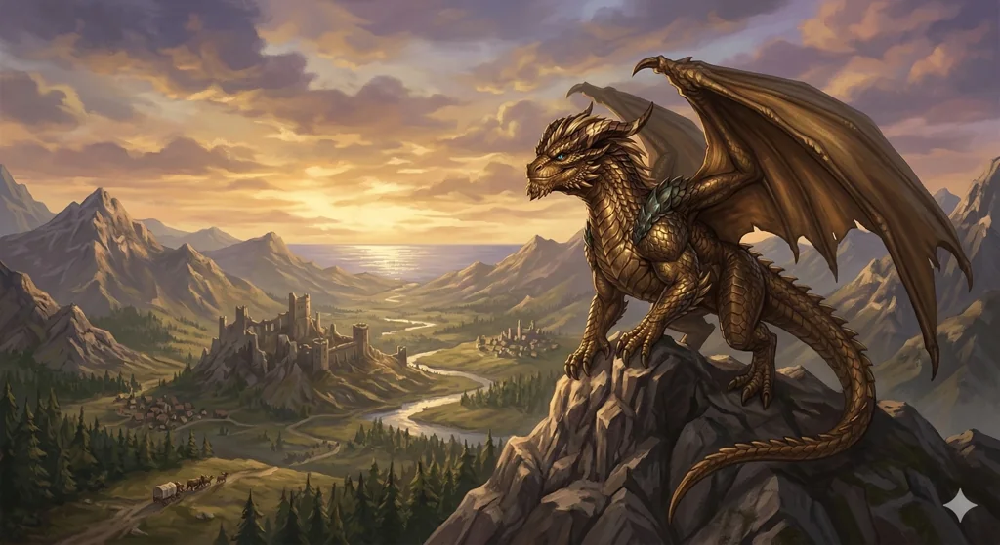

_Brązowy smok, niegdyś zaprzysiężony [[Adonis Neurdagon|Adonisowi Neurdagonowi]]; prawdziwa postać boga [[Pythor|Pythora]], który po pęknięciu Przysięgi Pokoju stracił boską moc. W Bitwie o Mytros wierzchowiec [[Orion Xul|Oriona]]._

## Opis
Wspaniały smok o lśniących łuskach.

W [[Sesja 75 - Koniec Przysięgi]] okazało się, że Raspytrion to prawdziwe imię Pythora; w [[Sesja 77 - Bitwa o Mytros: Upadek Icarusa]] opisano go jako „dawniej Pythor", dziś brązowy smok. Jest synem [[Sybolkorax|Sybolkoraxa]] i [[Balmytria|Balmytrii]].

## Osobowość
Cechy charakteru, motywacje, ideały.

## Historia
Zniknął bez śladu pod koniec Pierwszej Wojny. Spekuluje się, że mógł zostać pojmany przez Tytanów ([[Sesja 38 - Bitwa w Kalderze]]).

W [[Sesja 77 - Bitwa o Mytros: Upadek Icarusa]] wraz z [[Tysophale]] zanurkował na zmutowanego [[Icarus|Icarusa]] w [[Stadion Mytros|kolosseum]], zatapiając w jego skażonym ciele kły i pazury. Po walce został wyczerpany — [[Arevon Elorrenthi|Arevon]] uleczył go magią po pokonaniu bestii.

W [[Sesja 78 - Bitwa o Mytros: Przebudzenie Kolosa]] razem z pozostałymi smokami przetransportował drużynę nad miastem do [[Kolos Pythora|Kolosa Pythora]].

W [[Sesja 79 - Bitwa o Mytros: Gniew Pana Burz]] służył jako wierzchowiec [[Orion Xul|Oriona Xula]]. Został dotkliwie ranny uderzeniem glewii [[Sydon|Sydona]], lecz utrzymał się w powietrzu.

W [[Sesja 83 - Zmierzch Ery Tytanów]] ponownie niósł [[Orion Xul|Oriona Xula]] do boju, tym razem przeciw [[Kentimane|Kentimane'owi]]. Jedno z uderzeń [[Tytani|Tytana]] strąciło go z nieba — zwiotczał w locie i runął nieprzytomny, a [[Orion Xul|Orion]] spadł razem z nim.
