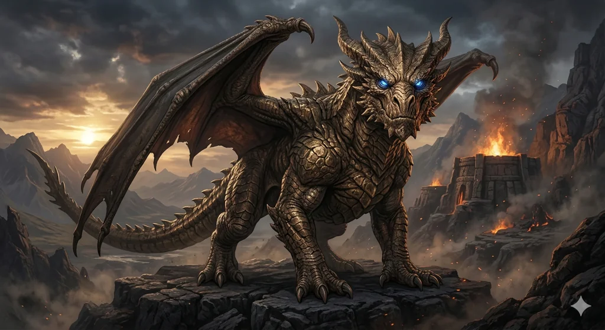

_Brązowy smok, partner [[Balmytria|Balmytrii]] i smok [[Rizon Phobas|Rizona Phobasa]]; prawdziwa postać boga [[Volkan|Volkana]], który po pęknięciu Przysięgi Pokoju stracił boską moc. Po wojnie osiadł z [[Orestes|Orestesem]] w [[Orestessos Zythikē]]._

## Opis
Potężny brązowy smok, jeden z najstarszych w Zakonie.

W [[Sesja 75 - Koniec Przysięgi]] okazało się, że Sybolkorax to prawdziwe imię Volkana. W [[Sesja 76 - Bitwa o Mytros: Pierwsza Fala]] jest opisywany jako brązowy smok-kowal, a w [[Sesja 77 - Bitwa o Mytros: Upadek Icarusa]] jako niegdyś bóg-kowal, dziś już tylko brązowy smok pozbawiony boskiej mocy. Jest ojcem [[Kyrah]] ([[Arkyrania]]) i [[Pythor|Pythora]] ([[Raspytrion]]).

## Osobowość
Pogrążył się w rozpaczy po śmierci [[Balmytria|Balmytrii]] ([[Sesja 75 - Koniec Przysięgi]]).

## Historia
Niegdyś partner [[Balmytria|Balmytrii]] i ojciec jej dzieci.

W [[Sesja 75 - Koniec Przysięgi]] ujawnił swoje prawdziwe imię jako smok Rizona Phobasa.

W [[Sesja 77 - Bitwa o Mytros: Upadek Icarusa]] leżał w stanie *near-death* na piaskowej arenie [[Stadion Mytros|kolosseum]] po starciu ze zmutowanym [[Icarus|Icarusem]]. Po zwycięstwie nad smokiem [[Arevon Elorrenthi|Arevon]] przywrócił go do życia maratonem uzdrowień. To Sybolkorax ujawnił drużynie plan przebudzenia [[Kolos Pythora|Kolosa Pythora]] jako mecha-boga, wskazując [[Rod of Rulership]] dzierżone przez [[Acastus|Acastusa]] jako klucz do aktywacji giganta.

W [[Sesja 78 - Bitwa o Mytros: Przebudzenie Kolosa]], po wyleczeniu ran potężną magią Arevona i Versira, Sybolkorax wraz z pozostałymi sprzymierzonymi smokami przetransportował bohaterów drogą powietrzną nad zrujnowanym miastem do portu w Mytros, umożliwiając im szybkie dotarcie na szczyt monumentu Pythora w celu jego aktywacji.

W [[Sesja 79 - Bitwa o Mytros: Gniew Pana Burz]] służył jako wierzchowiec [[Orestes|Orestesa]]. Został unieruchomiony przez olbrzymiego [[Gyganie|Gygana]], który pochwycił jego ogon w miażdżący uścisk.

W [[Sesja 80 - Bitwa o Mytros: Śmierć Pana Burz]] jako smok-wierzchowiec Orestesa został raniony przez [[Sydon|Sydona]] glewią, a później ogłuszony w locie dwoma cięciami. W [[Sesja 81 - Bitwa o Mytros: Koszmar na Targu Minotaurów]] wzbił się w powietrze i zionął błyskawicą w [[Lutheria|Lutherię]], zadając jej duże obrażenia.

W [[Sesja 83 - Zmierzch Ery Tytanów]] wraz z [[Arkyrania|Arkyranią]], [[Tysophale]] i [[Raspytrion|Raspytrionem]] rozpostarł skrzydła nad ruinami [[Mytros]], niosąc bohaterów do ostatniego starcia z [[Kentimane|Kentimane'em]].

W [[Sesja 84 - Świt Nowej Ery]] jako Volkan osiadł u boku Orestesa w [[Orestessos Zythikē]] (patrz [[Volkan]]).
