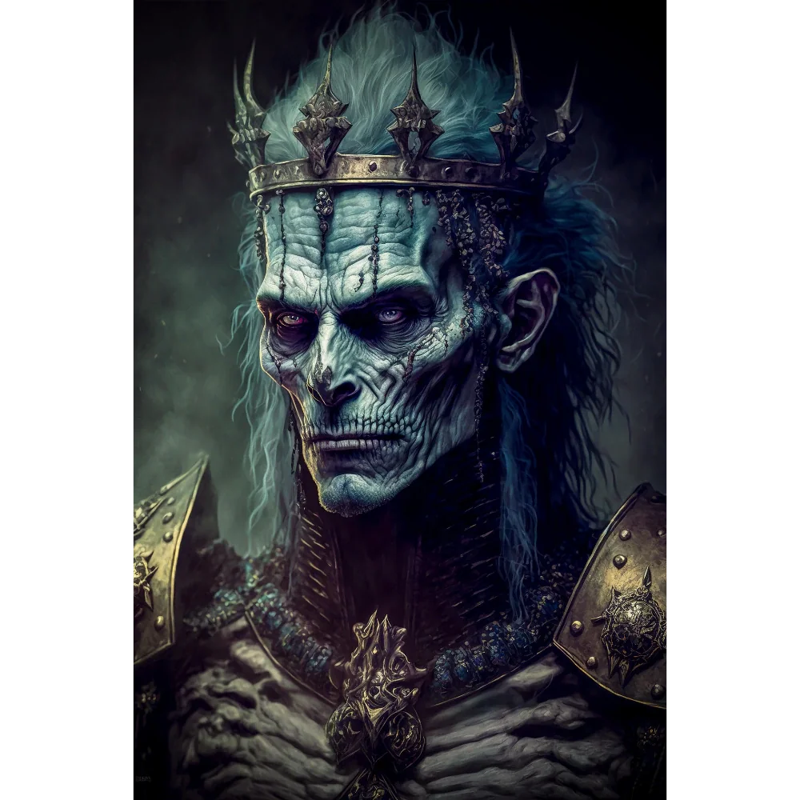

_Pierwszy przywódca Smoczych Lordów, zamordowany przez Karpathosa. Jego szczątki spoczywają w Nekropolii w Telamok._

## Osobowość
Według Estora: "Wdzięczący się głupiec".

## Historia
Pierwszy przywódca [[Smoczy Lordowie|Smoczych Lordów]]. Jego syn [[Gregor Huorath]] był ojcem [[Isadore Huorath|Isadore]] ([[Sesja 66 - Przebudzenie Bestii i Cienie Otchłani]]).

W [[Sesja 9 - W Głębi Grobowca Xandera]] jego duch ukazał się bohaterom w grobowcu, po pokonaniu strażnika [[Graxis Rzeźnik|Graxisa]]. Przekazał im swoje dziedzictwo: [[Topór Xandera]], [[Tarcza Xandera|Tarczę Xandera]] oraz [[Korona Smoczych Lordów|Koronę Smoczych Lordów]], a następnie zniknął.

W [[Sesja 61 - Yala, Arezja i Żółw]] bohaterowie dowiedzieli się, że zamordował go [[Karpathos]], któremu w ucieczce pomógł [[Narsus]].

W [[Sesja 84 - Świt Nowej Ery]] [[Felicjan Janus Twardowski|Felicjan]] zaproponował, by czaszkę [[Balmytria|Balmytrii]] złożyć w [[Nekropolia w Telamok|Nekropolii w Telamok]], obok jego szczątków.
