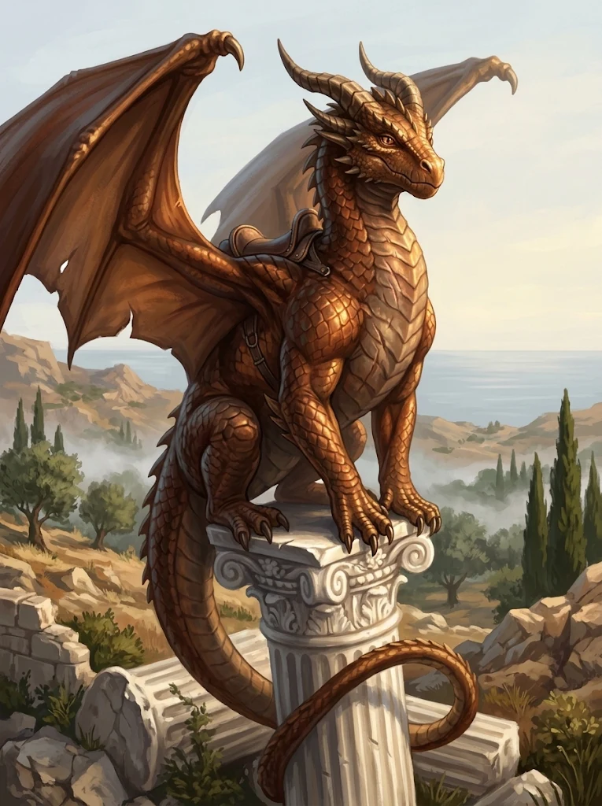

_Miedziany smok [[Alexandros|Alexandrosa]], dawny wierzchowiec jeźdźców króla [[Acastus|Acastusa]]._

## Opis
Krępy, ciężki miedziany smok o łuskach barwy wypolerowanej miedzi z ciemniejszymi pasami na grzbiecie. Nosi blizny z wojny, a jedno skrzydło ma naderwane. Spokojniejszy od [[Erythra|Erythry]], ale poczucia humoru miedzianym smokom nie brakuje. Jego imię znaczy „płomienny”.

## Historia
Wykluł się z jednego z jaj, które [[Sydon]] w tajemnicy dał [[Acastus|Acastusowi]]; król stworzył na tych smokach własnych „[[Smoczy Lordowie|Smoczych Lordów]]”. Dosiadał go [[Alexandros]], jeden z jeźdźców króla.

## Po wojnie
Razem z Alexandrosem przeszedł do [[Zakon Smoczych Lordów|Zakonu Smoczych Lordów]] [[Felicjan Janus Twardowski|Felicjana]]. Po piętnastu latach jest młodym, pełnoprawnym smokiem.
