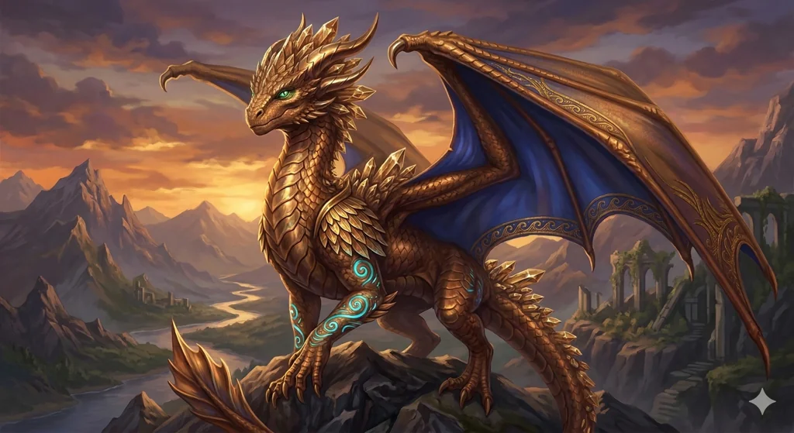

_Brązowy smok, niegdyś smok [[Jasena Ventrak|Jaseny Ventrak]]; prawdziwa postać boga [[Narsus|Narsusa]], który po pęknięciu Przysięgi Pokoju stracił boską moc._

## Opis
Dorosły brązowy smok, syn [[Balmytria|Balmytrii]] i [[Volkan|Volkana]] ([[Sybolkorax|Sybolkoraxa]]), brat [[Kyrah]] ([[Arkyrania|Arkyranii]]), [[Pythor|Pythora]] ([[Raspytrion|Raspytriona]]) i [[Vallus]] ([[Tysophale]]). Jako Narsus był czczony w [[Arezja|Arezji]] jako bóg piękna (patrz [[Narsus]]).

## Osobowość
Próżny i wpatrzony we własne odbicie (patrz [[Narsus]]).

## Historia
Był jednym ze smoków Zakonu, zaprzysiężonym Jasenie Ventrak. Według [[Xanderiada|Xanderiady]] Jasena opuściła Zakon niedługo po utracie swojego smoka.

W [[Sesja 86 - Trzy Klucze Teogenezy]] leżał na stosie jedwabnych poduszek w [[Komnata Piękna|Komnacie Piękna]] pod [[Świątynia Tarczy|Świątynią Tarczy]], wpatrzony w owalne zwierciadło i narzekający, że już cztery jego łuski straciły blask (patrz [[Narsus]]).
