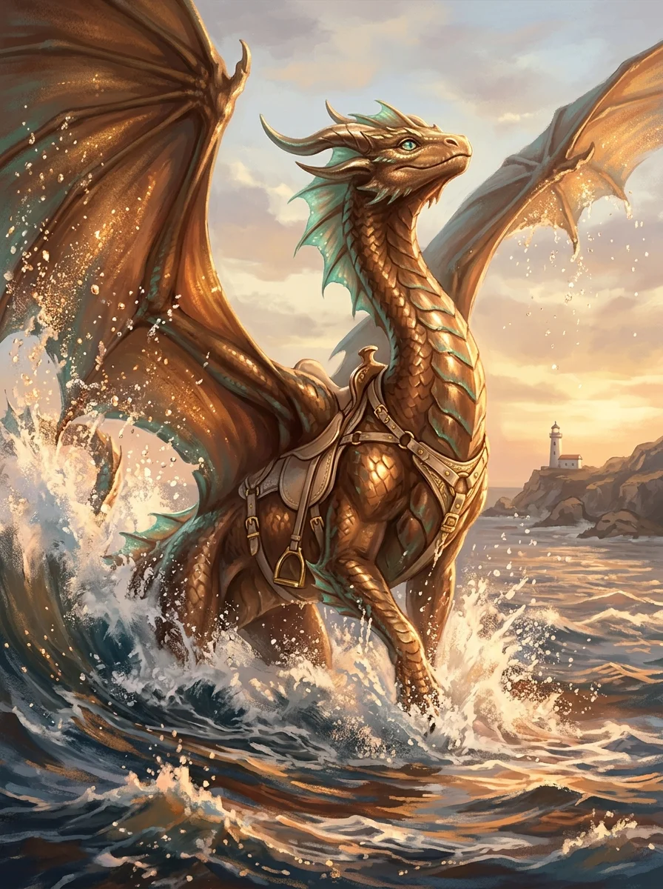

_Brązowa smoczyca z [[Wyspa Yonder|Yonder]], która wykluła się po wojnie z Tytanami._

## Opis
Młoda brązowa smoczyca wychowana w siedzibie odbudowanego [[Zakon Smoczych Lordów|Zakonu Smoczych Lordów]], razem z [[Kairos|Kairosem]] i [[Paradoks|Paradoksem]]. [[Felicjan Janus Twardowski|Felicjan]] traktuje młode smoki trochę jak własne dzieci. Dosiada jej [[Corinna]].

## Historia
W [[Sesja 84 - Świt Nowej Ery]] drużyna ustaliła, że dla wyklutej po wojnie smoczycy trzeba będzie znaleźć jeźdźca; padła kandydatura [[Corinna|Corinny]] i to ona została jej jeźdźczynią.
