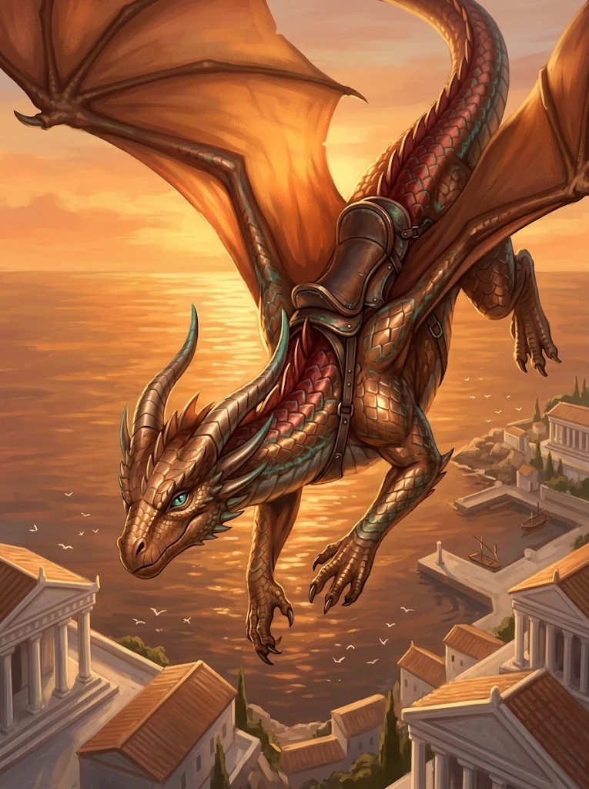

_Miedziana smoczyca [[Apasia|Apasii]], dawny wierzchowiec jeźdźców króla [[Acastus|Acastusa]]._

## Opis
Smukła, zwinna miedziana smoczyca o łuskach przechodzących na grzbiecie w czerwonawą miedź, z zielonkawą patyną na krawędziach łusek. Jej imię znaczy „czerwona”. Jak każdy miedziany smok uwielbia żarty i zagadki.

## Historia
Wykluła się z jednego z jaj, które [[Sydon]] w tajemnicy dał [[Acastus|Acastusowi]]; król stworzył na tych smokach własnych „[[Smoczy Lordowie|Smoczych Lordów]]”. W [[Sesja 76 - Bitwa o Mytros: Pierwsza Fala]] Apasia na jej grzbiecie złapała w locie spadającego Acastusa.

## Po wojnie
Razem z Apasią przeszła do [[Zakon Smoczych Lordów|Zakonu Smoczych Lordów]] [[Felicjan Janus Twardowski|Felicjana]]. Po piętnastu latach jest młodym, pełnoprawnym smokiem.
