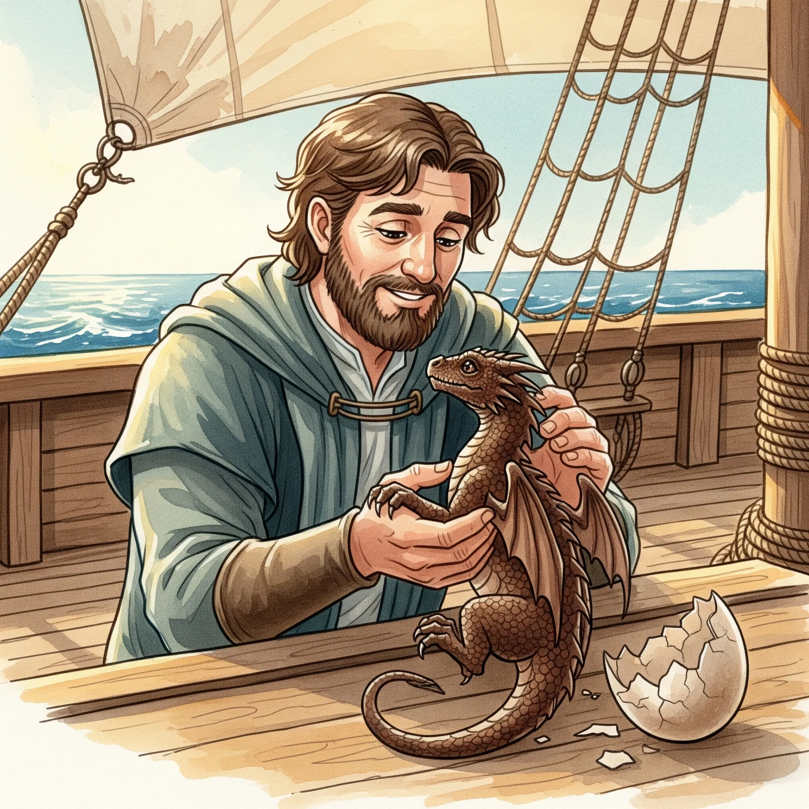

_Młody smok Felicjana, związany z nim przysięgą Smoczych Lordów._

## Opis
Kairos to samiec, który wykluł się z jaja brązowego smoka, które [[Felicjan Janus Twardowski|Felicjan]] nosił przy sobie przez długi czas. Rozwijał się w zdumiewającym tempie i był żarłoczny, lecz mniej absorbujący niż jego poprzednik. Do końca wyprawy urósł na tyle, że jest nieco większy od [[Paradoks|Paradoksa]], który jest już niewiele mniejszy od niego.

Niewielki smok o lśniących, brązowych łuskach, energiczny i ciekawski.

## Historia
Wykluł się na pokładzie statku [[Ultros]] w [[Sesja 48 - Pakty z Mojrami i Zew Chimery]], gdy statek płynął w stronę [[Wyspa Forlorn|Wyspy Forlorn]]. Felicjan nazwał go Kairosem i natychmiast przystąpił do rytuału tworzenia więzi, wypowiadając nad nim słowa starożytnej przysięgi [[Smoczy Lordowie|Smoczych Lordów]]. [[Pythor]] uznał jego narodziny za znak odrodzenia dawnej chwały. Podczas lądowania na wyspie Kairos, spłoszony hukiem i ogniem w walce z Płonącymi Czaszkami, szczęśliwie odskoczył i uniknął obrażeń.

W [[Sesja 50 - Nawałnica Tytanów i Szepty Yonder]] rozwijał się w zdumiewającym tempie; był żarłoczny, lecz nie wyrywał już kanapek z rąk, co załoga przyjęła z ulgą.

W [[Sesja 54 - Wyznanie Chondrusa]] został opisany jako młody, brązowy smok Felicjana, integrujący się z załogą pod okiem starszego smoka.

W [[Sesja 71 - Infiltracja Praxys]] jest wspomniany jako młody smok, z którym Felicjan już jakiś czas temu związał się przysięgą Smoczych Lordów.

W [[Sesja 84 - Świt Nowej Ery]] jest większy od Paradoksa, który mimo to jest już niewiele od niego mniejszy.
