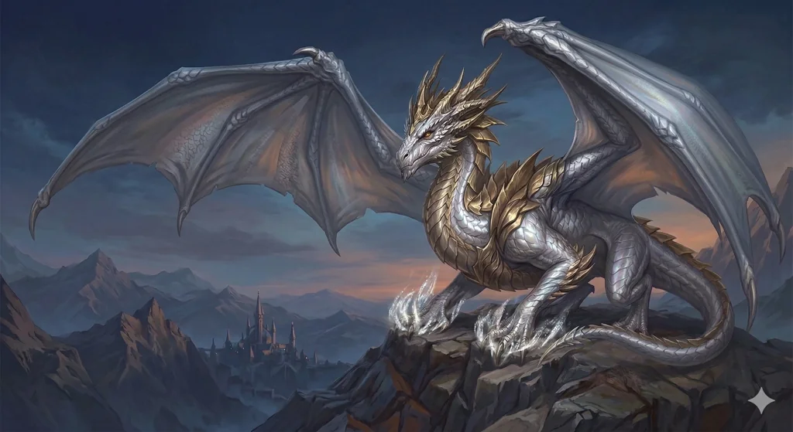

_Potężna smoczyca, bezduszny klon Balmytrii._

## Opis
Srebrnołuska, majestatyczna smoczyca z wieży [[Praxys]], która przedstawiła się jako „Matka Smoków". Jest sztucznym klonem [[Balmytria|Balmytrii]] stworzonym przez [[Sydon|Sydona]], pozbawionym własnej duszy; kieruje się czystym instynktem i pragnieniem wolności oraz zemsty. Zginęła w bitwie o Mytros ([[Sesja 80 - Bitwa o Mytros: Śmierć Pana Burz]]), a jej wskrzeszone ciało zamieszkała dusza [[Despina|Despiny]]; po bitwie odleciała na południowy wschód i opuściła Mytros ([[Sesja 81 - Bitwa o Mytros: Koszmar na Targu Minotaurów]]).

## Historia
W [[Sesja 74 - Matka Smoków]] drużyna znalazła w komnacie w [[Praxys]] potężną smoczycę przykutą łańcuchami i pilnowaną przez dwóch gyganów. Przedstawiła się: „Jestem Nephele. Jestem matką smoków." Uwolnił ją topór [[Orestes|Orestesa]]. Po uwolnieniu rzuciła się na martwego gygana i zaczęła go pożerać z przerażającą brutalnością; pytała o Sydona („Gdzie Sydon?"), nie wykazała też zainteresowania ocalałym srebrnym smoczym jajem. Została krwiożerczym, niepewnym sojusznikiem drużyny i towarzyszyła jej w windzie. Sydon pracował nad klonowaniem po Przysiędze Pokoju, tworząc „idealną maszynę do produkcji smoczych dzieci".

W [[Sesja 75 - Koniec Przysięgi]] pomogła drużynie w walce, zionąc mroźnym oddechem i sypiąc odłamkami lodu, które odłamywały gargulcom kończyny; pożarła też sześciorękiego [[Gyganie|Gygana]]-maga. Na pokładzie [[Ultros|Ultrosa]] bogowie [[Volkan]], [[Pythor]] i [[Kyrah]] zamarli na jej widok i na widok czaszki Balmytrii.

W [[Sesja 80 - Bitwa o Mytros: Śmierć Pana Burz]] walczyła po stronie bohaterów przeciw Sydonowi: jako pierwsza zionęła w Tytana falą przenikliwego mrozu, później owiała mrozem także burzową chmurę. Sydon skupił na niej całą swoją furię, powalił ją, po czym ją dobił; jej martwe ciało dryfowało w kierunku plaży. [[Arevon Elorrenthi|Arevon]] skomentował: „Ona nie żyje. To jest RIP."

W [[Sesja 81 - Bitwa o Mytros: Koszmar na Targu Minotaurów]] jej martwe ciało zostało wskrzeszone zaklęciem *Revivify* rzuconym przez Arevona. Ponieważ jej własna dusza nie mogła powrócić do ciała, zamieszkała je dusza [[Despina|Despiny]] uwolniona z pękniętego amuletu [[Felicjan Janus Twardowski|Felicjana]]; nowe ciało miało 1 punkt życia i wymagało odpoczynku. Po krótkim odpoczynku na plaży smoczyca rozpostarła skrzydła i odleciała na południowy wschód, opuszczając Mytros.
