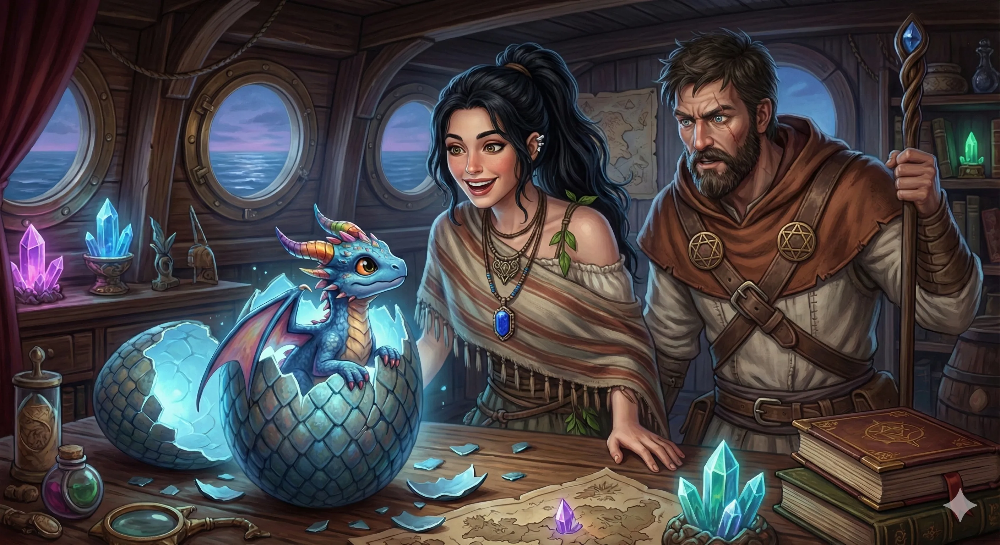

_Niebieski smok wykluty ze Smoczego Jaja na pokładzie Ultrosa._

## Opis
Młode smoczątko o niebieskawych łuskach i charakterystycznych, wielobarwnych rogach. Wykluł się z jaja zwanego "Paradoksem". Do końca wyprawy rósł zupełnie standardowo i jest już niewiele mniejszy od [[Kairos|Kairosa]]; teoretycznie ktoś mógłby na nim zasiąść.

## Osobowość
Od urodzenia wykazuje wysoką inteligencję i zdolność mowy. Jest chętny do walki, "palenia wrogów i jedzenia ich ciał". Zadeklarował lojalność wobec załogi [[Ultros|Ultrosa]]. Według [[Felicjan Janus Twardowski|Felicjana]] wymaga wyjątkowo mądrego jeźdźca.

## Historia
W [[Sesja 58 - Wyspa Czasu]] spotkany przez bohaterów jako dziwaczny smok strzegący rozdroża na [[Wyspa Czasu|Wyspie Czasu]]. Zażądał rozwiązania trzech zagadek, by przepuścić podróżnych, a drużyna odpowiedziała poprawnie.

Z biegiem czasu na wyspie stawał się coraz młodszy.

W [[Sesja 59 - Koniec Imprezy]] bohaterowie wrócili do Przejścia Przez Czas, gdzie zwykle napotykali smoka, ale tym razem znaleźli tylko jego smocze jajo. [[Felicjan Janus Twardowski|Felicjan]] zdecydował się zabrać je na [[Ultros]].

W [[Sesja 65 - Wyprawa w Otchłań]] jajo zaczęło pękać w kajucie Felicjana podczas rejsu ku [[Morze Otchłani|Morzu Otchłani]]. Na świat przyszło niewielkie smoczątko o niebieskawych łuskach i wielobarwnych rogach. Wykazało natychmiastową inteligencję, pytając o obecny rok, a Felicjan powitał je w roku 499. Smok był lekko zaskoczony, że nie wykluł się na znajomej mu Wyspie Czasu, ale chętnie dołączył do załogi Ultrosa i szybko zadeklarował chęć walki u boku bohaterów, pytając o możliwość „palenia wrogów i jedzenia ich ciał”.

W [[Sesja 71 - Infiltracja Praxys]] [[Orestes]] próbował zyskać jego lojalność, kusząc go darmowym piwem i ciepłym leżem na zapleczu rzemieślniczego browaru. Paradoks zapytał, czy dla uwarzenia idealnego piwa Orestes cofnąłby się w czasie i namieszał w czasoprzestrzeni. Po radosnym przyznaniu się Orestesa do takiego pomysłu, uznał jego ambicje za nieodpowiedzialne i mizerne i stanowczo odrzucił umowę.

W [[Sesja 84 - Świt Nowej Ery]], mimo swojego osobliwego pochodzenia i imienia, rósł zupełnie standardowo. Jedyny, który kiedyś go sobie wybrał, spotkał się z odmową: Orestes wskazał wtedy na Paradoksa, a Paradoks minotaura nie chciał. Felicjan złośliwie przypominał, że Orestes wybrał sobie najtrudniejszego z możliwych wierzchowców.
