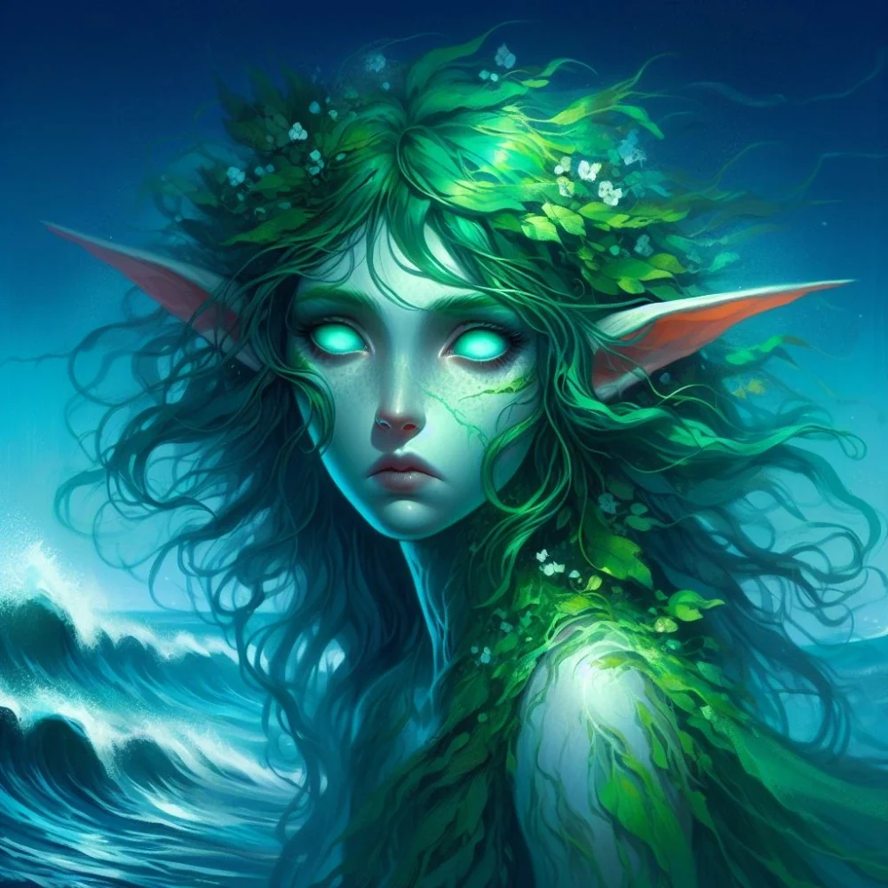

_Duch driady związany z masztem Ultrosa. Po wojnie odeszła ze statku._

Królowa Driad ze Starego Lasu, władczyni leśnych ludów Fey w czasach przybycia [[Smoczy Lordowie|Smoczych Lordów]].

## Historia
Podczas wojny z Tytanami i [[Gyganie|Gyganami]] zginęła z rąk [[Estor Arkelander|Estora Arkelandera]], który ściął jej święte drzewo, by uczynić z niego maszt swojego okrętu, [[Ultros|Ultrosa]].

W [[Sesja 24 - Ultros]] spotkała się z drużyną na pokładzie [[Ultros|Ultrosa]] jako duch driady związany ze statkiem. Wyjawiła, że [[Estor Arkelander|Estor]] zabił ją, a jej siostra [[Demetria]] przeżyła; drzewa, z którym była związana, użył do masztu Ultrosa. Po śmierci Estora dała [[Orestes|Orestesowi]], nowemu kapitanowi, wybór między ścieżką żywych a ścieżką umarłych. Orestes wybrał ścieżkę żywych, w wyniku czego cała nieumarła załoga opuściła statek.

W [[Sesja 76 - Bitwa o Mytros: Pierwsza Fala]], podczas przedzierania się Ultrosa przez blokadę w Dokach Mytros, objawiła się jako eteryczna postać na głównym maszcie. Gdy statek został trafiony głazem z trebusza, z każdego pęknięcia wyrosły pnącza, mech i kora, które go naprawiły, dzięki czemu statek wyprostował się jak ożywiony tytan i przebił blokadę [[Zakon Sydona|Zakonu Sydona]].

W [[Sesja 84 - Świt Nowej Ery]] okręt — pozbawiony już magicznych właściwości — został na stałe zacumowany w porcie [[Mytros]] i przerobiony na bar z muzeum. [[Orestes]] uznał, że Delphia może wreszcie odejść ze statku; podziękował jej za owocną współpracę, zaprosił na pożegnalne piwo i wypił jej zdrowie, życząc szerokiej drogi.
