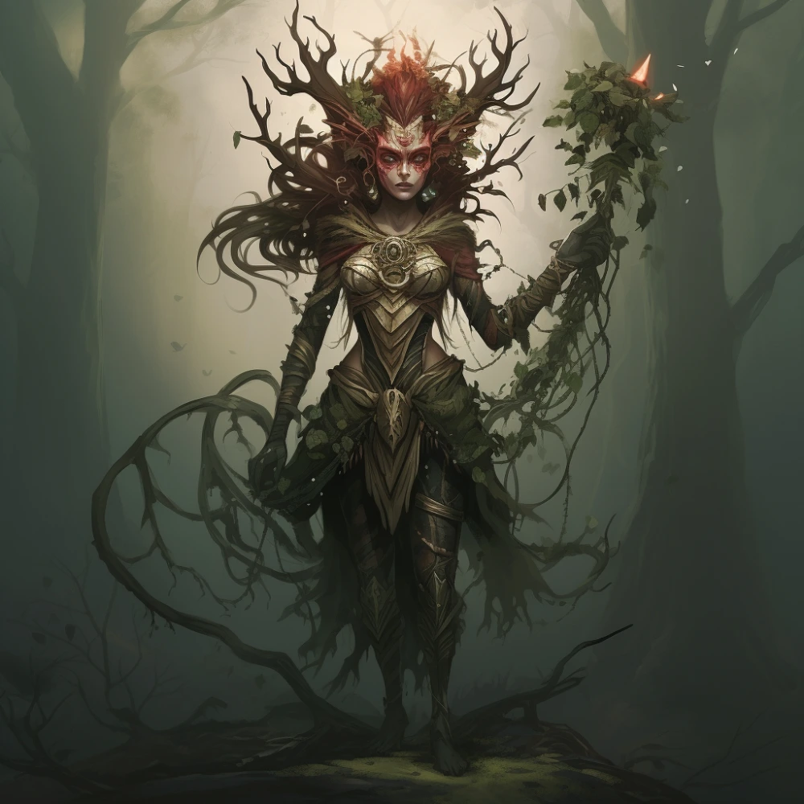

_Mściwa driada, władczyni Świątyni w Starym Lesie. Pokonana przez bohaterów._

## Opis
Demetria jest driadą, która uległa szaleństwu i nienawiści, a jej serce zepsuła [[Lutheria|Lutheria]].

## Osobowość
Nienawidzi śmiertelników, zwłaszcza mieszkańców [[Mytros]] i [[Estoria]]. Jest pała żądzą zemsty za czyny [[Smoczy Lordowie|smoczych lordów]]. Jest niezwykle piękna i potrafi czarować słowami, wabiąc nieostrożnych w pułapkę.

## Historia
Demetria oszalała z żalu i nienawiści po stracie siostry. Złożyła przysięgę wierności [[Lutheria|Lutherii]], która podsyciła jej gniew.

Demetria zaczęła porywać młodych ludzi z okolic [[Estoria|Estorii]], obiecując im wieczną młodość i piękno. W rzeczywistości kobiety zamieniała w krwiożercze [[Menaidy]], a mężczyzn zabijała i zjadała podczas rytualnych uczt. Jej słudzy skradli [[Róg Balmytrii]], aby wykarmić jej rosnące sługi. W Świątyni znajdowała się też mroczna księga [[Tome of Maenads]].

W [[Sesja 4 - Mroczne sekrety Świątyni]] bohaterowie podążyli śladami porwanych nastolatków do zrujnowanej [[Świątynia w Starym Lesie|Świątyni w Starym Lesie]], gdzie czaiła się driada Demetria. Po zaciętej walce pokonali ją i odzyskali [[Róg Balmytrii]]; uratowali też porwanych i znaleźli [[Tome of Maenads|księgę z ludzkiej skóry]] z mrocznymi rytuałami.

W [[Sesja 24 - Ultros]] z opowieści ducha [[Delphia|Delphii]] bohaterowie dowiedzieli się, że Demetria była jej siostrą i że [[Estor Arkelander|Estor Arkelander]] zabił Delphię, a z drzewa, z którym związana była Delphia, zrobił maszt [[Ultros|Ultrosa]].

W [[Sesja 68 - Arena Krzywoprzysięstwa]] pojawiła się na arenie w trzeciej fali jako mściwa driada ze [[Stary Las|Starego Lasu]], w towarzystwie [[Fekaliusz|Fekaliusza]], żywiołaka ścieków, i została pokonana przez drużynę.
