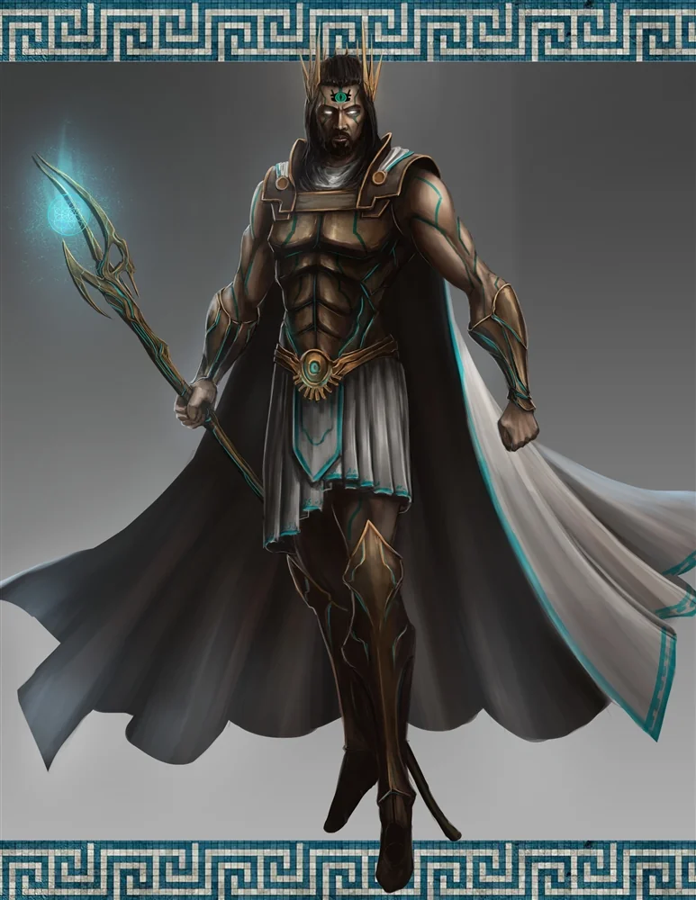

_Syn Sydona i Lutherii, dotknięty szaleństwem. Zginął z ręki Orestesa na swojej arenie w Praxys._

## Opis
Goloron był tytanem, synem [[Sydon|Sydona]] i [[Lutheria|Lutherii]]; szalonym, sadystycznym, o pustych oczach, które w gniewie zalewała atramentowa czerń, a z których sączyła się nekrotyczna energia. Emanował nekromantyczną mocą i dzierżył plugawą laskę. Potrafił znikać w kłębach mroku i pojawiać się w innym miejscu, latać, miotać mroczne zaklęcia, teleportować się i stawać niewidzialny, a w walce używał legendarnych akcji i psionicznego ataku, który ogłuszał ofiarę. Miał kochankę, nimfę [[Dianama|Dianamę]].

Jego obecność budziła niepokój.

## Historia
Podobnie jak reszta rodzeństwa, nosił imię po jednym z pierwotnych Tytanów — po wuju, [[Goloron Pierwszy|Goloronie Pierwszym]] ([[Sesja 70 - Audiencja u Pani Snów]]).

Pojawił się już w [[Sesja 14 - Burza nad Mytros]], wśród tytanów obecnych w tej sesji. Podczas spotkania na [[Góra Volkana|Górze Volkana]] jego spojrzenie zdradzało oznaki obłędu.

W [[Sesja 50 - Nawałnica Tytanów i Szepty Yonder]] stoczył epicką walkę z [[Kraken|Krakenem]] pośród morskiej burzy, rzucając mroczne zaklęcia i emanując nekromantyczną energią. Gdy walka dobiegła końca, wzbił się w powietrze i odleciał.

W [[Sesja 70 - Audiencja u Pani Snów]] [[Lutheria]] powiedziała, że większość jej dzieci wybrała ojca, ale Goloron, Strażnik Elizjum, wciąż czasem ją odwiedza.

W [[Sesja 73 - Praxys - Skarbiec Sydona]] czekał na bohaterów na poziomie Heavens w wieży [[Praxys]], gdzie prowadził krwawą arenę. Zasiadał na widowni oddzielonej od areny ścianą mocy (Wall of Force), w towarzystwie dwóch cyklopów i koźlaków, i z sadystyczną radością ogłosił: „Niech igrzyska się zaczną!". Zamknął za drużyną kratę i wypuścił na wyczerpanych bohaterów trzy młode smoki.

W [[Sesja 74 - Matka Smoków]] zasiadał na tronie jak groteskowy sędzia własnych igrzysk, dowodząc widownią cyklopów i koźlaków, trzema smokami i gyganami. Gdy [[Felicjan Janus Twardowski|Felicjan]] czarem Scatter przeniósł drużynę na podwyższenie obok jego tronu, stracił szalony uśmiech; w zamieszaniu użył psionicznego ataku na [[Versir|Versira]], teleportował się z powrotem na arenę i stał się niewidzialny. Później zaatakował [[Orestes|Orestesa]], zabił go, podniósł jego ciało jedną ręką i rzucił: „Mama będzie ze mnie dumna". Orestes wstał jednak dzięki klątwie Lutherii, która okazała się błogosławieństwem, i zadał mu ostateczny cios toporem od tyłu. Goloron rozprysnął się w chmurę złotego pyłu. Wśród jego komnat drużyna znalazła później pokój nimfy [[Dianama|Dianamy]], jego kochanki.
