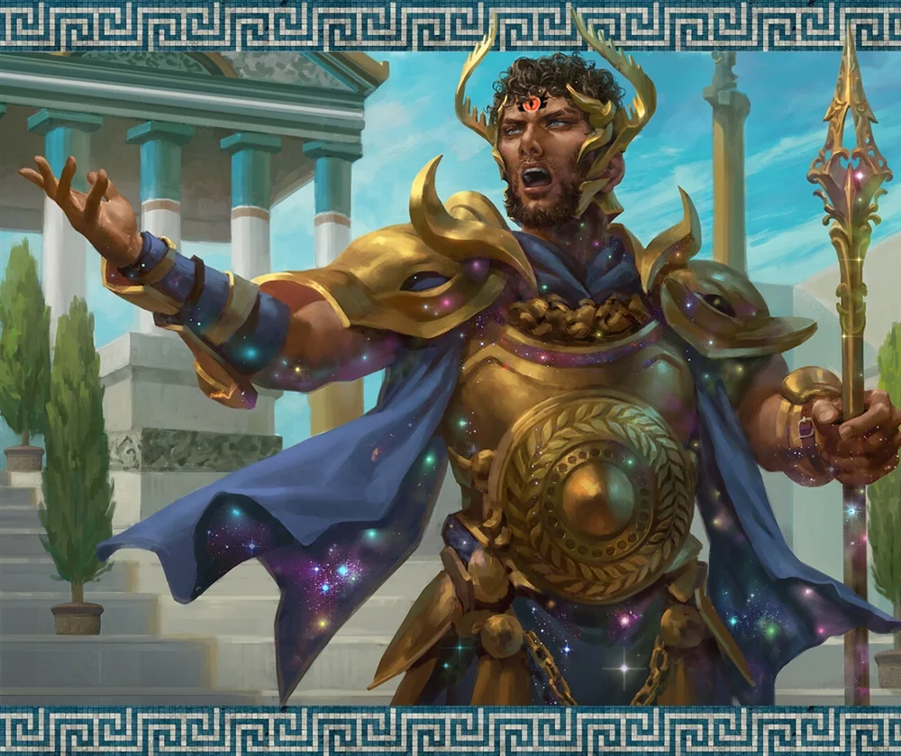

_Empyrejski syn Sydona i Lutherii, niestabilny półbóg. Zginął w Świątyni Pięciu w Mytros._

## Opis
Hergeron był potężnym półbogiem (empyreanem), synem [[Sydon|Sydona]] i [[Lutheria|Lutherii]], dzieckiem Bliźniaczych Tytanów. Lewitował, a w walce rzucał *Steel Wind Strike*, teleportując się między członkami drużyny; miał też legendarne akcje. Po wchłonięciu boskich iskier rodzeństwa stał się potężny, agresywny i niestabilny, a z jego oczu biło oślepiające, złote światło. W swoim dzienniku zapisywał wyniosłe przemyślenia o rodzeństwie i plany podboju.

## Historia
Podobnie jak reszta rodzeństwa, nosił imię po jednym z pierwotnych Tytanów — po wuju, [[Hergeron Pierwszy|Hergeronie Pierwszym]] ([[Sesja 70 - Audiencja u Pani Snów]]).

Był jednym z pięciorga dzieci Sydona, które wymieniono w [[Sesja 14 - Burza nad Mytros]]; podczas rytuału na [[Góra Volkana|Górze Volkana]] obserwował bohaterów w milczeniu.

W [[Sesja 7 - Uratować Księżniczkę]] obwinił [[Gaius|Commandera Gaiusa]] o porażkę związaną z niedopełnieniem ofiary z [[Anora|Anory]].

W [[Sesja 30 - Zakończenie Igrzysk]] w Wielkim Młynie prawie dobił [[Orion Xul|Oriona Xula]], po czym przegrał z siostrą, [[Yala|Yalą]].

W [[Sesja 50 - Nawałnica Tytanów i Szepty Yonder]] żołnierze [[Sydon|Sydona]] opowiadali, że gdy odwiedzał [[Wyspa Yonder|Yonder]], miał tam w bibliotece swoją sypialnię. W [[Sesja 51 - Desant na Yonder]] bohaterowie dowiedzieli się, że przybył na wyspę kilka dni wcześniej, prosto z [[Praxys]], i spędzał czas w bibliotece, pogrążony w studiowaniu starożytnych tomów. [[Arevon Elorrenthi|Arevon]] zobaczył go przed świątynią w ożywionej, być może gniewnej dyskusji z [[Gaius|Gaiusem]]; po niej wzbił się w powietrze i odleciał na północ.

W [[Sesja 52 - Infiltracja Yonder]] drużyna znalazła w jego zamkniętych na klucz komnatach w bibliotece dziennik ([[Dziennik Hergerona]]), [[List do Lutherii]] oraz pozłacaną skrzynię. W [[Sesja 53 - Koniec Yonder]] w skrzyni były pierścienie, platyna i plany naprawy magicznego kompasu.

W [[Sesja 55 - Egida Mytros]] [[Arevon Elorrenthi|Arevon]] zaszpiegował go czarem *Scrying*: Hergeron przejął bezpośrednią władzę nad [[Zakon Sydona|Zakonem Sydona]], zażądał zmiany planów wojennych oraz zemsty na [[Bohaterowie Przepowiedni|Bohaterach Przepowiedni]]. Dziennik Hergerona przekazano [[Vallus]].

W [[Sesja 76 - Bitwa o Mytros: Pierwsza Fala]] zaatakował [[Świątynia Pięciu]]: wymordował akolitów, powalił posągi bogów, a towarzyszył mu oddział centaurów, minotaurów i gyganów. Powitał drużynę pogardliwym monologiem o szczurach, które kąsają kostki prawdziwych władców, i cieszył się ze śmierci rodzeństwa, bo zyskiwał dzięki niej więcej potęgi i boskości; w jego oczach migotały niestabilne, boskie iskry. Zmierzył się z drużyną, zadając jej potężne rany czarem *Steel Wind Strike*, po czym otrzymał potężny, krytyczny cios od [[Orestes|Orestesa]]. Do końca sesji wciąż stał, ale był silnie poturbowany, a jego eskorta w większości wybita.

W [[Sesja 77 - Bitwa o Mytros: Upadek Icarusa]] **zginął** w [[Świątynia Pięciu|Świątyni Pięciu]]. Mimo licznych ran wciąż lewitował groźnie w powietrzu, raniąc [[Orestes|Orestesa]] szpadą i próbując dosięgnąć [[Arevon Elorrenthi|Arevona]], lecz to druid zadał mu ostateczny cios — wezwany przez niego fey teleportował się za plecy empyreana i wbił mu **dwa widmowe sztylety w pośladki**, kładąc syna [[Sydon|Sydona]] i [[Lutheria|Lutherii]] trupem na posadzce świątyni. Z jego szat [[Arevon Elorrenthi|Arevon]] wyłuskał [[Złota Moneta Hergerona|wielką złotą monetę]] — klucz do jednych z drzwi w wieży [[Praxys]].
