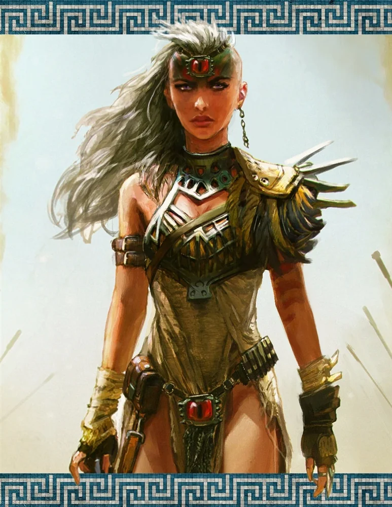

_Córka Sydona i Lutherii, ostatnie żyjące dziecko Tytanów. Po upadku Kentimane'a pozostała strażniczką pokoju na wyspie Amazonek._

## Opis
Yala jest tytanką, córką [[Sydon|Sydona]] i [[Lutheria|Lutherii]], a przy tym amazonką; skonfliktowaną lojalnością wobec rodziców i [[Amazonki|Amazonek]]. Jako jedyna z rodzeństwa przeżyła wojnę po stronie Mytros, choć mieszkańcy miasta wciąż nie przyjmują jej życzliwie. Na plecach ma wypalone tatuaże, z których potrafi uwolnić płomienną burzę. Po wojnie nie przyjęła władzy nad Amazonkami i jest jedynie strażniczką pokoju na [[Themis|wyspie]].

Wydaje się darzyć innych pewnym szacunkiem, a przynajmniej ciekawością pozbawioną wrogości; w przeciwieństwie do rodzeństwa nie okazuje pogardy ani szaleństwa.

## Historia
Podobnie jak reszta rodzeństwa, nosiła imię po jednym z pierwotnych Tytanów — po ciotce, [[Yala Pierwsza|Yali Pierwszej]] ([[Sesja 70 - Audiencja u Pani Snów]]).

Pojawiła się już w [[Sesja 14 - Burza nad Mytros]], wśród tytanów obecnych w tej sesji. Podczas spotkania na [[Góra Volkana|Górze Volkana]] spoglądała na bohaterów z szacunkiem.

W [[Sesja 30 - Zakończenie Igrzysk]] okazała się w Wielkim Młynie trudnym przeciwnikiem i pokonała swojego brata [[Hergeron|Hergerona]].

W [[Sesja 34 - Ivello i Drapaczka do Pleców]] nie było wiadomo, po której stronie stanie w konflikcie o tron Amazonek; widziano ją w okolicy pałacu Amazonek podczas polowania.

W [[Sesja 35 - W Wężowym Uścisku]] spotkała się z bohaterami w [[Kaplica Płodności]]. Była zaskoczona ich przybyciem — spodziewała się ich, ale nie tak szybko. Po rozmowie zgodziła się nie mieszać w konflikt o tron Amazonek ([[Sesja 36 - Królowa, Dziedzic i Generał]]).

W [[Sesja 76 - Bitwa o Mytros: Pierwsza Fala]] [[Arevon Elorrenthi|Arevon]] zobaczył ją czarem *Scrying*: siedziała samotnie na klifie, wpatrując się z zadumą w odległe [[Mytros]].

W [[Sesja 83 - Zmierzch Ery Tytanów]] przyleciała do [[Mytros]] na krótko przed nadejściem [[Kentimane|Kentimane'a]] i stanęła po stronie miasta przeciw własnemu dziadkowi — jako ostatnie żyjące dziecko [[Tytani|Tytanów]] wśród obrońców.  To ona wskazała drużynie trzy możliwe drogi: poddać się, kruszyć [[Kentimane|Sturękiego]] powoli siłą wszystkich sojuszników, albo okazać mu potęgę i godnie rozkazać mu odejść. W samej bitwie uwolniła płomienną burzę z tatuaży wypalonych na plecach, po czym jako pierwsza znalazła się w miażdżącym uścisku dziadka — straciła przytomność, a [[Kentimane]] wlókł jej bezwładne ciało za sobą przez pola.

W [[Sesja 84 - Świt Nowej Ery]] pozostała długiem, którego nie dało się spłacić monetą. Mimo udziału w odparciu [[Kentimane|Kentimane'a]] wciąż nie była mile widziana przez mieszkańców [[Mytros]] — pojawiła się na chwilę po wszystkim, ale źle się tu czuła i szybko zniknęła. [[Versir]] uznał zmienianie opinii tłumu za stratę czasu i zamiast tego zabrał się za kronikarzy i historyków, dopilnowując, by na kartach historii zapisała się wersja prawdziwa: ta, w której Yala pomogła obronić miasto. Władzy nad [[Amazonki|Amazonkami]] nie przyjęła, pozostając jedynie strażniczką pokoju na [[Themis|wyspie]].
