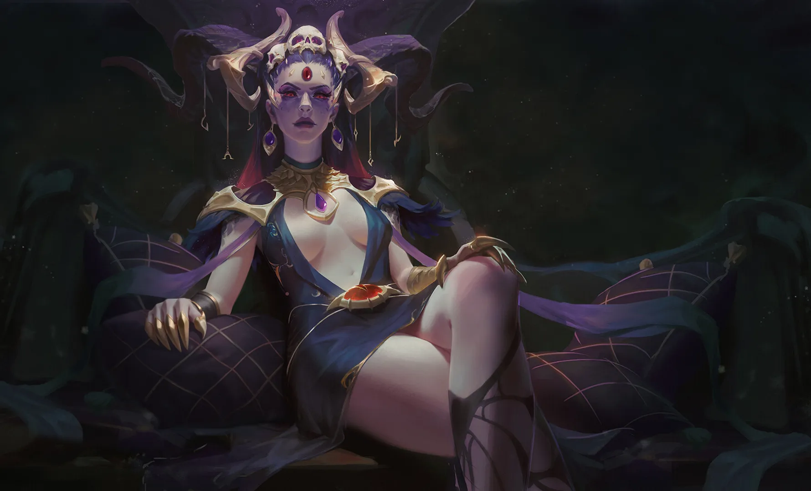

_Siostra i żona Sydona, Pani Snów i Śmierci. Zginęła w [[Sesja 82 - Bitwa o Mytros: Śmierć Pani Snów|sesji 82]], ścięta przez Orestesa Toporem Xandera._

## Opis
Przyjmowała postać pięknej kobiety o czarnych oczach, która lunatykuje przez zaświaty, witając duchy zmarłych. Na czole posiadała trzecie oko, które zazwyczaj pozostawało zamknięte, lecz gdy je otwierała, widziała oczami zmarłych w zaświatach – wtedy poruszało się ono niezależnie od jej pozostałych oczu. <!-- UNSOURCED -->

Lutheria była Tytanką i boginią śmierci, zwaną Panią Snów i Panią Śmierci; siostrą i żoną [[Sydon|Sydona]], z którym narodziła się z siódmego nasiona [[Drzewo Serca|Drzewa Serca]], oraz matką m.in. [[Goloron|Golorona]], [[Hergeron|Hergerona]], [[Talieus Pierwszy|Talieusa]] i [[Chalcia|Chalcii]]. Dzierżyła [[Kryształowa Kosa Lutherii|kryształową kosę]], w której uwięziła m.in. dusze rodziców [[Orestes|Orestesa]]; po jej śmierci kosa została rozbita w [[Sesja 84 - Świt Nowej Ery]]. Jej statkiem był [[Hypnos]], a domena — [[Świat Snów]] — po jej śmierci stoi pusta.

## Osobowość
*   **Ciekawska:** Interesuje się światami poza Thyleą, cywilizacjami i bogami. <!-- UNSOURCED -->
*   **Pozornie Empatyczna:** Rozumie nadzieje i lęki śmiertelników. Jest czarująca i przystępna (z nutą szaleństwa), rzadko oceniająca. Złodzieje i mordercy czczą ją, licząc na wybaczenie. <!-- UNSOURCED -->
*   **Manipulująca:** Lubi paktować, oferując spełnienie marzeń za przerażającą cenę. <!-- UNSOURCED -->
*   **Cyniczna i okrutna:** W [[Sesja 70 - Audiencja u Pani Snów|sesji 70]] opowiadała żarty o martwych niemowlętach i nie dała się sprowokować do walki; w [[Sesja 68 - Arena Krzywoprzysięstwa|sesji 68]] okazała rozbawienie zamiast gniewu. Nawet ciężko ranna uśmiechała się i bawiła się walką ([[Sesja 82 - Bitwa o Mytros: Śmierć Pani Snów|sesja 82]]).

Uważała rasy śmiertelne za zabawki i czerpała satysfakcję ze sprowadzania ich do poziomu bestii. Stworzyła menady i koźludzi (goatlings) jako kpinę z ludzkich osadników. <!-- UNSOURCED -->

## Historia
Niegdyś bogini wielu rzeczy, mówi się, że stworzyła rasy fey, w tym satyrów, nimfy i driady. Ucierpiała równie mocno jak [[Sydon]], gdy ludzkość przybyła do Thylei – jej dzieci zostały wymordowane. Jest Boginią Podziemi, Królową [[Morze Otchłani|Morza Otchłani]]. <!-- UNSOURCED -->

Według [[Sesja 39 - Tajemnice Wyspy Złotego Serca|sesji 39]] była bliźniaczką Sydona, zrodzoną z siódmego nasiona [[Drzewo Serca|Drzewa Serca]]; wraz z nim odrzuciła pomysł stworzenia pomniejszych istot. Omamiła [[Talieus Pierwszy|Talieusa]], w zemście go oślepiła i zmusiła do ciągnięcia swojego okrętu flagowego (w [[Sesja 66 - Przebudzenie Bestii i Cienie Otchłani|sesji 66]] Talieus wciąż ciągnął jej okręt [[Hypnos]]), a sprowadzony przez nią meteoryt roztrzaskał [[Versi]]. Wraz z Sydonem nadała swoim dzieciom imiona pokonanych tytanów ([[Sesja 21 - Ukryte pragnienia Ismene]]) i szeptała [[Yala|Yali]] zatrute słowa, że jest tylko piękna i delikatna ([[Sesja 61 - Yala, Arezja i Żółw]]); w [[Sesja 65 - Wyprawa w Otchłań|sesji 65]] zastawiła pułapkę na swoje rodzeństwo na [[Wyspa Złotego Serca|Wyspie Złotego Serca]]. Dawno temu nałożyła na [[Orestes|Orestesa]] klątwę dającą mu dodatkowe życia ([[Sesja 74 - Matka Smoków]]), a według Wiedźmy Lotosu — klątwę pecha ([[Sesja 41 - Wiedźma Lotosu]]). Miała też dawny pakt z [[Estor Arkelander|Estorem Arkelanderem]], którego oszukała ([[Sesja 24 - Ultros]]) i któremu przepowiedziała śmierć z ręki Orestesa ([[Sesja 67 - Zguba Estora]]). Przed [[Przysięga Pokoju|Przysięgą Pokoju]] pomogła Sydonowi wygrać siódmą partię Królewskiej Gry z [[Balmytria|Balmytrią]] ([[Sesja 75 - Koniec Przysięgi]]); jako Pani Snów podpisała Przysięgę.

W [[Sesja 25 - Inauguracja Wielkich Igrzysk]] przybyła na stadion w [[Mytros]] przez wyrwę w rzeczywistości wyciętą kryształową kosą, przyprowadzając ze sobą własną drużynę nieumarłych czempionów i drwiąc z zasad króla [[Acastus|Acastusa]]. W [[Sesja 30 - Zakończenie Igrzysk]] zatańczyła z Acastusem na uczcie, przemawiała w imieniu nieobecnego Sydona i wzniosła toast za Thyleę, bohaterów i przyszłość; odwiedziła też [[Versir|Versira]] we śnie i złożyła mu ofertę, którą on wzgardził. W [[Sesja 38 - Bitwa w Kalderze]] [[Chalcia]] oskarżyła ją o zdradę rodziny Versira.

W [[Sesja 42 - Plemię Węgorza]] bohaterowie znaleźli na wyspie poświęconą jej kapliczkę. W [[Sesja 47 - Wyspa Mojr]] gobelin pokazał Versirowi jego własną śmierć z jej rąk. W [[Sesja 54 - Wyznanie Chondrusa]] dowiedziano się, że [[Chondrus]] jej służył, a sama Lutheria — jak twierdził — nie pragnęła totalnej wojny i była obserwatorką; stygijskie mewy były jej oczami i uszami. W [[Sesja 55 - Egida Mytros]] [[Vallus]] uznała, że utrzymanie Pani Snów w neutralności wobec wojny z Sydonem może być kluczowe.

W [[Sesja 66 - Przebudzenie Bestii i Cienie Otchłani]] przybyła do [[Sześcian Więzienny|Sześcianu Więziennego]], zaalarmowana hałasem, i przez [[Kalisto]] zaprosiła drużynę na ucztę na pokładzie [[Hypnos|Hypnosa]], gwarantując Prawo Gościnności. W [[Sesja 68 - Arena Krzywoprzysięstwa]] pojawiła się na trybunach areny, gdy przestrzeń nad nią się rozdarła; na wyspie, która leżała w jej domenie, przeprosiła za spóźnienie i wyraziła nadzieję, że goście dobrze bawią się w jej domenie. W [[Sesja 69 - Ogród Lutherii]] oklaskiwała zwycięzców areny na stojąco i ponowiła zaproszenie na [[Hypnos]] przy ujściu [[Rzeka Lethe|rzeki Lethe]]; wspierała wówczas Sydona w nadchodzącej wojnie, a drużyna chciała ją od tego odwieść.

W [[Sesja 70 - Audiencja u Pani Snów]] przyjęła bohaterów. Zszyła usta [[Estor Arkelander|Estora Arkelandera]], po czym jego ciało rozpadło się w pył. Twierdziła, że Sydon stał się dla niej ciężarem, i wyjawiła, że ma on uczulenie na gwiazdy, a na szczycie [[Praxys]] jest gwiazda z Morza Astralnego, podtrzymująca wieżę, której fundamentem jest jej brat Hergeron. Zasugerowała, by drużyna eliminowała jej potomstwo pojedynczo w wieży. Zaoferowała oddanie Kosy wraz z duszami za [[Glewia Sydona|Glewię Sydona]] i głowę jej brata-męża; umówiono się luźno po fakcie. Obiecała zachować neutralność w nadchodzącym konflikcie z Sydonem. W [[Sesja 73 - Praxys - Skarbiec Sydona]] w prywatnych komnatach Sydona znaleziono obraz przedstawiający jej stopy.

W [[Sesja 75 - Koniec Przysięgi]] wraz z końcem Przysięgi Pokoju boskie domeny wróciły do niej i Sydona, którzy stali się potężniejsi niż kiedykolwiek.

W [[Sesja 80 - Bitwa o Mytros: Śmierć Pana Burz]] pojawiła się tuż po śmierci [[Sydon|Sydona]], zamieniając triumf bohaterów w koszmar. Na czele makabrycznego orszaku nieumarłych, spętanych duchów i rzeczy bez nazwy wkroczyła do [[Mytros]], dzierżąc kryształową kosę. Machnięciem dłoni zamieniała ocalałych mieszkańców w kozy, krowy i świnie, a sam jej widok doprowadzał pozostałych do obłędu i ludożerczego szału. Z daleka jej spojrzenie odnalazło bohaterów na wodzie, posyłając im nieme, mroczne zaproszenie — sesja zakończyła się cliffhangerem.

W [[Sesja 81 - Bitwa o Mytros: Koszmar na Targu Minotaurów]] zatrzymała się na [[Targ Minotaurów|Targu Minotaurów]], otoczyła go mgłą i urządziła makabryczną ucztę, zmuszając mieszkańców do ludożerstwa i obłędu. Utrzymywała, że nigdy nie była wrogiem bohaterów, i proponowała wspólne budowanie nowego świata. Przejrzała podstępny atak [[Orestes|Orestesa]] i zabiła go czarem *Finger of Death* (Orestes powstał jako nieumarły zombie, który mimo wrogiego czaru wspomagał drużynę). Ujawniła, że Sydon był ukochanym synem [[Kentimane|Kentimane'a]]. Ostatecznie, ciężko ranna w starciu z bohaterami, [[Kolos Pythora|Kolosem Pythora]] oraz smokiem [[Sybolkorax|Sybolkoraxem]], teleportowała się, ostrzegając ich przed nadchodzącym gniewem sturękiego tytana Kentimane'a.

W [[Sesja 82 - Bitwa o Mytros: Śmierć Pani Snów]] **zginęła**. Po wygaśnięciu [[Przysięga Pokoju|Przysięgi Pokoju]] odzyskała odebraną jej przed wiekami muzykę — rdzeń swojej mocy — i przez całe starcie śpiewała, poświęcając osobną, szyderczą pieśń każdemu z [[Bohaterowie Przepowiedni|Bohaterów Przepowiedni]]. Gdy zwykły oręż okazał się niewystarczający (jej ciało ustępowało tylko broni godnej Tytanki, takiej jak [[Zguba Tytanów]] czy [[Topór Xandera]]), wciągnęła drużynę do [[Świat Snów|Świata Snów]] — swojej domeny — otaczając się siedmioma identycznymi odbiciami. Raniła bohaterów [[Kryształowa Kosa Lutherii|kryształową kosą]], lecząc się ich krwią, paraliżowała psionicznymi krzykami i wygnała [[Versir|Versira]] do wielowymiarowego labiryntu; uderzenie Zgubą Tytanów zdławiło jej zdolność do leczenia się cudzym cierpieniem. Gdy [[Felicjan Janus Twardowski|Felicjan]] odnalazł ją wśród fantazmatów, a kolejne odbicia zaczęły pękać, [[Świat Snów]] załamał się i odesłał wszystkich z powrotem na [[Targ Minotaurów]]. Pozbawiona domeny, odbić i ostatniego wsparcia — Lamii, którą dobił [[Orion Xul|Orion]] — skurczyła się do rozmiarów zwykłej kobiety, usiadła na podeście i **dobrowolnie przestała walczyć** — „No to była dobra partia. Na pewno was wszystkich zapamiętam". [[Orestes]] odciął jej głowę [[Topór Xandera|Toporem Xandera]], a jej ciało rozsypało się w złoty pył, zostawiając jedynie kosę. Wraz z jej śmiercią magia nad [[Mytros]] rozwiała się: zwierzęta odzyskały ludzkie kształty, a szaleńcy zmysły.

W [[Sesja 83 - Zmierzch Ery Tytanów]] jej śmierć przypisywano Orestesowi, a opowieść o tym rozchodziła się po Mytros i obrastała w legendę; zapowiadane przez umierającą nadejście [[Kentimane|Kentimane'a]] spełniło się. W [[Sesja 84 - Świt Nowej Ery]] Versir odnalazł jej barkę [[Hypnos]] przy ujściu rzeki Lethe, z wciąż przykutym [[Talieus Pierwszy|Talieusem Pierwszym]], którego uwolnił; kryształowa kosa pękła i rozpadła się, a uwięzione w niej dusze uleciały.
