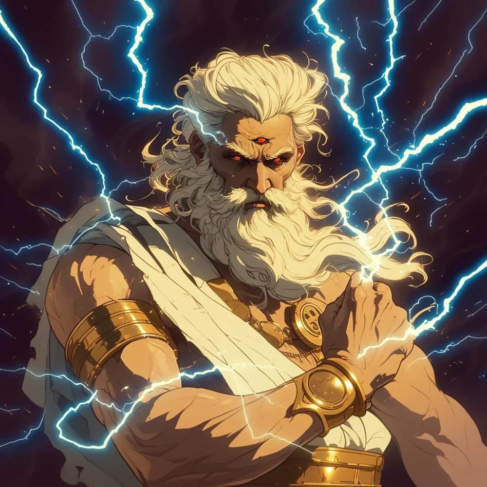

_Władca Burz i Pan Oceanów, jeden z Bliźniaczych Tytanów. Zginął w [[Sesja 80 - Bitwa o Mytros: Śmierć Pana Burz|sesji 80]], pokonany w bitwie o Mytros._

## Opis
Sydon, Władca Burz, był potężnym tytanem, uosobieniem burzy i oceanu, zwanym też Panem Burz, Tytanem Burz i Panem Oceanów.
Dzierżył potężną czarną glewię ([[Glewia Sydona]]), przywoływał niszczycielskie błyskawice, a każde trafienie w jego ciało wyzwalało mściwe wyładowania elektryczne. Miał trzecie oko na czole. Był ojcem m.in. [[Versi]], [[Yala|Yali]], [[Chalcia|Chalcii]], [[Goloron|Golorona]], [[Hergeron|Hergerona]] i [[Talieus Pierwszy|Talieusa]] oraz bratem i mężem [[Lutheria|Lutherii]].
Niegdyś czczony był jako pan całej Thylei.

## Osobowość
Gwałtowny, dumny i mściwy. Uważa śmiertelników za złodziei, którzy ukradli Thyleę. Domaga się wyłącznego kultu (nie toleruje czci innych bogów poza [[Lutheria|Lutherią]]).
Jest zazdrosnym bogiem, który uważa, że tylko on ma prawo do rządzenia. "Pozwól mi pokazać ci przyszłość Thylei. A wtedy, być może, zdecydujesz, czy chcesz być jej częścią." — słowa do [[Acastus|Króla Acastusa]].
Według [[Chondrus|Chondrusa]] był tępym, żądnym władzy tyranem ([[Sesja 54 - Wyznanie Chondrusa]]). W [[Sesja 72 - Śniadanie u Tytana Bochenek Przeznaczenia|sesji 72]] zareagował na atak ze znudzeniem i pogardą, a w [[Sesja 73 - Praxys - Skarbiec Sydona|sesji 73]] okazał się narcystyczny: w sypialni miał nagi marmurowy posąg siebie naturalnej wielkości.

## Historia
Gdy ludzkość przybyła i podbiła jego ziemie, a [[Smoczy Lordowie]] nękali go, w gniewie zniszczył ich smoki i szukał zemsty. Wtedy narodziło się [[Pięciu Bogów]], którzy odebrali mu siłę i wykuli [[Przysięga Pokoju|Przysięgę Pokoju]].

Wraz z [[Lutheria|Lutherią]] rządził Thyleą przez eony, zanim przybyli [[Smoczy Lordowie]]. Po Pierwszej Wojnie został zmuszony do zawarcia [[Przysięga Pokoju|Przysięgi Pokoju]] z [[Pięciu Bogów|Pięcioma Bogami]], która na pięćset lat ograniczyła jego wpływ na śmiertelników. W miarę jak magia przysięgi słabła, Sydon coraz śmielej manifestował swoją wolę, nękając [[Estoria|Estorię]] suszą i żądając krwawych ofiar, takich jak ta z księżniczki [[Anora|Anory]].

Według [[Sesja 39 - Tajemnice Wyspy Złotego Serca|sesji 39]] był bliźniakiem Lutherii, zrodzonym z siódmego nasiona [[Drzewo Serca|Drzewa Serca]]; wraz z nią odrzucił pomysł stworzenia pomniejszych istot, a moc [[Talieus Pierwszy|Talieusa]] przekazał mu [[Kentimane]]. Z Lutherią nadali swoim dzieciom imiona pokonanych tytanów ([[Sesja 21 - Ukryte pragnienia Ismene]]); [[Sesja 61 - Yala, Arezja i Żółw|sesja 61]] ukazuje, jak szeptali [[Yala|Yali]] zatrute słowa, wmawiając jej, że jest tylko piękna i delikatna. Przed Przysięgą Pokoju zagrał z [[Balmytria|Balmytrią]] w Królewską Grę i w siódmej partii, wsparty przez Lutherię, wygrał, co pozwoliło jej zdobyć ich domeny ([[Sesja 75 - Koniec Przysięgi]]).

Sydon wysłał do [[Heleka|Heleki]] list z rozkazem przyprowadzenia swojej córki [[Versi]].

W [[Sesja 2 - Przepowiednia]] na jego rozkaz uwięziono jego córkę, Wyrocznię [[Versi]].

W [[Sesja 25 - Inauguracja Wielkich Igrzysk]] pojawił się na Wielkich Igrzyskach w [[Mytros]]: wśród burzowych chmur okrążył stadion na wielkich orlich skrzydłach i wylądował na balkonie, gdzie powitał go król [[Acastus]] (który osobiście go zaprosił). Zażądał nowej tradycji walk z minotaurami. W [[Sesja 30 - Zakończenie Igrzysk]] opuścił Igrzyska przed ucztą z powodu „pilnych spraw”.

W [[Sesja 37 - Próba Ognia]] dostarczył Chodzącym w Ogniu nowego kowala. W [[Sesja 39 - Tajemnice Wyspy Złotego Serca]] wywołał burzę na Zatoce Cerulańskiej, ciskając w bohaterów wszystkim, co miał, lecz bezskutecznie. W [[Sesja 44 - Ventis]] obiecał [[Ventis]] panowanie nad wyspą. W [[Sesja 47 - Wyspa Mojr]] okazało się, że zapłacił [[Mojry|Mojrom]] za rzucenie klątwy na smocze jaja; w [[Sesja 48 - Pakty z Mojrami i Zew Chimery]] wyśmiał roszczenia [[Despina|Despiny]], wygnał ją i skazał na śmierć, a jego kostur, który dzierżył [[Versir]], został w zamian za zdjęcie klątwy poświęcony Mojrom i zniszczony.

W [[Sesja 50 - Nawałnica Tytanów i Szepty Yonder]] drużyna odkryła, że przemieszcza wyspy tajnymi szlakami morskimi. W sesjach 51–53 ([[Sesja 52 - Infiltracja Yonder]]) odkryto jego świątynię na [[Wyspa Yonder|Yonder]] i konspekt planu inwazji na Thyleę z udziałem gigantów, centaurów i zdrady w Mytros, a [[Sesja 55 - Egida Mytros]] dodała sabotaż od wewnątrz i atak centaurów na Estorię. W [[Sesja 56 - Dedal i Ikar]] zabił [[Ochos Arkelander|Ochosa]] piorunem czystej boskiej mocy. W [[Sesja 57 - Ogród Heliosa]] zmusił [[Helios|Heliosa]] do paktu i przysięgi oddania mu cyklopów jako żołnierzy w nadchodzącej wojnie ([[Sesja 68 - Arena Krzywoprzysięstwa]]).

W [[Sesja 72 - Śniadanie u Tytana Bochenek Przeznaczenia]] stoczył szybką potyczkę z intruzami w wieży [[Praxys]]. Kiedy sięgał po śniadanie w postaci wielkiego bochenka chleba uszykowanego na stół, prosto w jego twarz wybuchnął [[Orestes]], zadając tytanowi spektakularny, furiacki cios. Sydon natychmiast odpłacił się magiczną glewią i poraził przeciwników potężnymi błyskawicami. Widząc jednak siłę ciosów oraz wezwanego z zaświatów Widmowego Smoka ze strony herosów, zraniony i znużony wycofał się z walki, rozpływając się w powietrzu: „Zepsuliście mi śniadanie. Znużyliście mnie. Zobaczymy się w Mytros”. W zastępstwie kazał swojej córce [[Chalcia|Chalcii]] zająć się gośćmi i udowodnić, że jest godna boskości.

Jego siedzibą była wieża [[Praxys]] ([[Sesja 63 - Werdykt Arezji]], [[Sesja 70 - Audiencja u Pani Snów]]). W [[Sesja 73 - Praxys - Skarbiec Sydona]] drużyna splądrowała jego skarbiec i prywatne komnaty: zabezpieczył resztki statku Tranquility w dokach i uwięził [[Stavros|Stavrosa]] w lochach za odmowę dołączenia do swojej armii. W [[Sesja 74 - Matka Smoków]] okazało się, że po Przysiędze Pokoju pracował nad klonowaniem [[Balmytria|Balmytrii]], tworząc [[Nephele (Smok)|Nephele]], a w [[Sesja 75 - Koniec Przysięgi]], że uwięził na szczycie Praxys dziecko istot z Morza Astralnego jako boskie trofeum. Z końcem Przysięgi Pokoju boskie domeny wróciły do niego i Lutherii, którzy stali się potężniejsi niż kiedykolwiek.

W [[Sesja 76 - Bitwa o Mytros: Pierwsza Fala]] zamanifestował się w porcie Mytros w gigantycznym wirującym leju wody, by zmyć miasto tsunami; wyszydził Acastusa, nazywając go narzędziem. W [[Sesja 78 - Bitwa o Mytros: Przebudzenie Kolosa]] wkroczył na pole bitwy osobiście, a jego mosiężne automatony i węże morskie uderzyły na miasto i [[Ultros]].

W [[Sesja 79 - Bitwa o Mytros: Gniew Pana Burz]], uwolniony z okowów Przysięgi Pokoju, stawił czoła Bohaterom Przepowiedni w [[Mytros]]. Został zaatakowany przez [[Orestes|Orestesa]], [[Felicjan Janus Twardowski|Felicjana]] sterującego [[Kolos Pythora|Kolosem Pythora]] oraz [[Versir|Versira]], który po teleportacji pod jego oblicze zadał mu dwa cięcia nakładające klątwę odcinającą go od uzdrawiania. Sydon odpowiedział aroganckim dialogiem oraz cięciem glewii, którym dotkliwie ranił smoka [[Raspytrion|Raspytriona]].

W [[Sesja 80 - Bitwa o Mytros: Śmierć Pana Burz]] **zginął**. Powietrzno-morskie starcie nad zatoką [[Mytros]] przypieczętowało jego los: dosiadający smoków bohaterowie, [[Kolos Pythora]] oraz przywoływane raz po raz inkarnacje niebiańskiej [[Trąba|Trąby]] nękały Tytana bez wytchnienia, a [[Versir]] świetlistymi cięciami [[Zguba Tytanów|Zguby Tytanów]] wypalał w jego ciele rany, które nie chciały się goić. Sydon zdołał jeszcze dobić smoczycę [[Nephele (Smok)|Nephele]] i uśmiercić kolejne wcielenia [[Trąba|Trąby]], lecz ostatecznie [[Orestes]], szarżując na smoczym grzbiecie, wbił [[Topór Xandera|Toporem Xandera]] prosto w jego trzecie oko. Ciało Władcy Burz rozpadło się od środka, obracając się w popiół i złoty pył. Jego śmierć wywołała potężne tąpnięcie i trzęsienie ziemi, a wygasły wulkan [[Kuźnia Volkana|Góra Volkana]] przebudził się, plując dymem i ogniem. Po Tytanie pozostała jedynie porzucona, nietknięta [[Glewia Sydona]]. Jego armia wpadła w popłoch, a nienaturalna burza nad Mytros zaczęła cichnąć; jego martwe cielsko osunęło się w fale ([[Sesja 81 - Bitwa o Mytros: Koszmar na Targu Minotaurów]]).

W [[Sesja 83 - Zmierzch Ery Tytanów]] Orestes potwierdził, że Sydona nie ma i nie będzie, a jego legiony się rozproszyły. W [[Sesja 84 - Świt Nowej Ery]] okazało się, że przerobił okręt [[Tranquility]], tak że napęd słucha także osób bez Znamienia Burzy; Acastus prosił o łagodne kary dla ludzi, którzy stanęli po jego stronie.
