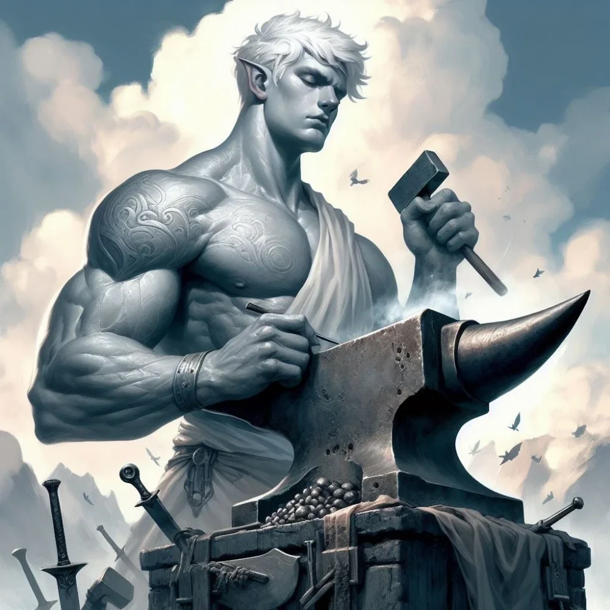

_Tytan Rzemiosła. Uwolniony przez Versira z łańcuchów po stuleciach męki; jego esencja spoczywa w Rękawicy Versira._

## Historia
Pierworodny z rodzeństwa pierwotnych Tytanów, wuj [[Versir|Versira]].

Stworzył rdzenne rasy (centaury, satyry, nimfy, gigantów, cyklopów), by nie czuć się samotnym ([[Sesja 39 - Tajemnice Wyspy Złotego Serca]]).

Omamiony przez przebiegłą [[Lutheria|Lutherię]] stworzył również **[[Myrmeki]]** — niszczycielską rasę insektoidów. To sprowadziło gniew jego ojca, [[Kentimane|Kentimane'a]], który uwięził myrmeki na jednej z wysp, a moc Talieusa przekazał [[Sydon|Sydonowi]]. Bezbronnego Talieusa uwięzili bliźniaczy Tytani: [[Lutheria]] w akcie zemsty go oślepiła i zmusiła do ciągnięcia swojego okrętu flagowego ([[Sesja 39 - Tajemnice Wyspy Złotego Serca]]). Zaszyła mu też usta ([[Sesja 84 - Świt Nowej Ery]]), by nie mógł wyjawić prawdy o swoim upadku.

Jest twórcą miecza **[[Zguba Tytanów]]** (Titansbane), w którym zaklęta jest cząstka duszy matki Versira, [[Versi Pierwsza|Versi Pierwszej]] ([[Sesja 70 - Audiencja u Pani Snów]]). Wykuł go na prośbę Versi.

W [[Sesja 61 - Yala, Arezja i Żółw]] we wspomnieniu raju ścigał się z [[Chalcia Pierwsza|Chalcią]].

W [[Sesja 64 - Pieśń dla Smoczycy]] drużyna wysłała zdobyty miecz do boga [[Volkan|Volkana]], by ten dokończył dzieło Talieusa.

W [[Sesja 66 - Przebudzenie Bestii i Cienie Otchłani]] został dostrzeżony przez bohaterów: gigantyczny, z oczami przesłoniętymi bandażami, brodził w czarnych wodach [[Morze Otchłani|Morza Otchłani]], ciągnąc na łańcuchach okręt [[Hypnos]] jak niewolnicze zwierzę pociągowe. [[Versir]] skontaktował się z nim telepatycznie, nazywając go wujkiem. Złamany Tytan odpowiedział jedynie: *"Jestem... złamany"*.

W [[Sesja 69 - Ogród Lutherii]] [[Versir]] pragnął odzyskać Talieusa i zabrać go ze sobą. W [[Sesja 70 - Audiencja u Pani Snów]] oskarżył [[Lutheria|Lutherię]] o próbę kradzieży „iskry życia" Talieusa, bo sama nie potrafiła tworzyć. W [[Sesja 72 - Śniadanie u Tytana Bochenek Przeznaczenia]] złota moneta z czerwonym okiem, której użył cyklop, była łudząco podobna do artefaktu noszonego niegdyś przez Talieusa.

W [[Sesja 84 - Świt Nowej Ery]] jego męka wreszcie się skończyła. Drużyna odnalazła zacumowanego [[Hypnos|Hypnosa]] niedaleko ujścia [[Rzeka Lethe|rzeki Lethe]], a Talieus wciąż tkwił przykuty do kadłuba — oślepiony, z zaszytymi ustami, zaprzęgnięty jak zwierzę pociągowe, bo to on był jedynym napędem barki. [[Versir]] zbił okowy i wyprzągł go z łańcuchów, włożył mu w dłoń [[Zguba Tytanów|Zgubę Tytanów]], ostrze, które sam Talieus niegdyś wykuł, i powiedział mu, że jego oprawcy nie żyją i że może wreszcie odpocząć. Złamany Tytan zdołał odpowiedzieć tylko: *„Tak, już czas"*. [[Versir]] uruchomił wtedy swoją magiczną rękawicę i wchłonął jego esencję, kończąc mękę trwającą stulecia.
